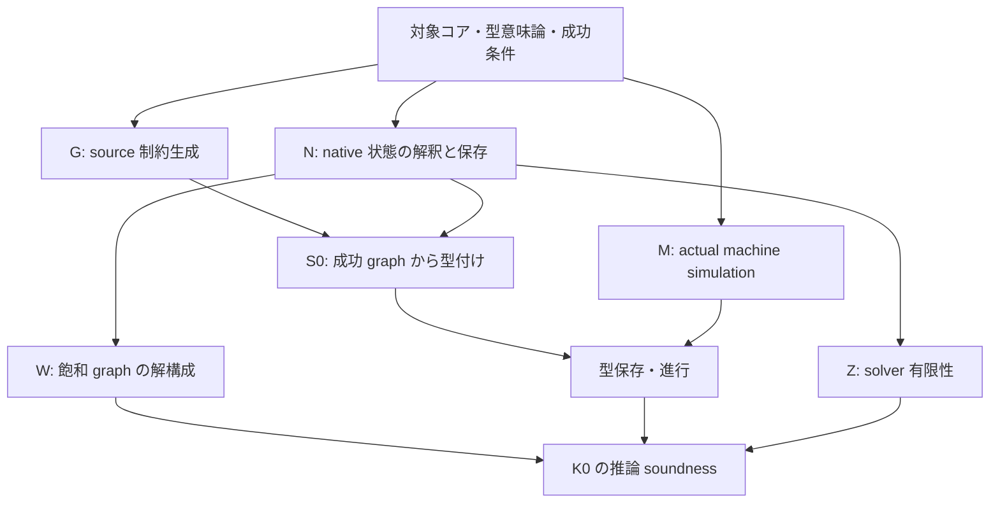
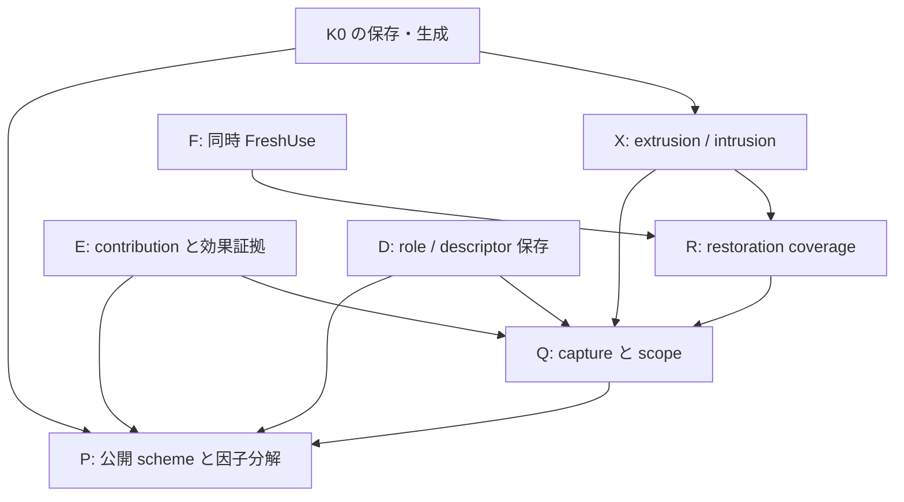

対象: [momota1029/yulang](https://github.com/momota1029/yulang)、branch `research/simple-sub-intrusion`\
監査基準: **18d10b95942fbb8775b92542884e5a55860670bc**（2026-10-23 12:20:24 JST。最終取得確認 12:26 JST）\
実施日: 2026-10-23。読み取り専用のコード・文書・タスク・テスト本文監査。手書き証明を含むが、機械検証済み証明ではない。

# 1. 結論

**全体証明への着手は可能であり、実装完成まで待つ必要はない。現在の全拡張実装について soundness・principality・停止性が成立したと結論するには、まだ根拠が足りない。**

最初の対象は、ordinary candidate 経路における、単一の非再帰定義の純粋な高階関数コア K0 とする。literal、parameter Name、単純な Value Lambda、Apply、else 付き If、Group、binding を含まない Block/StatementBlock を扱う。実装の Value/Effect row、正負の項、Function の四ポート、bound propagation、実際の playground machine を残す。この断片では全 live row の level が 1 のままという構築不変量を示せるため、高 level の extrusion copy とその parent/copy intrusion を全体証明の最初の経路から外せる。アルゴリズムを別物に置き換える必要はない。

並行して、既存コードについて **FreshUse の canonical row map と構造項の同時置換補題**を証明できる。本報告の第8節に完全な証明を置く。これは第8.1節の前提を満たす任意の有限 captured graph に関する補題で、特定の Button サンプルに依存しない。ただし Capture の完全性、一般化対象の選択、bound restoration、source soundness の完成ではない。

全体証明への主な不足は機能数ではなく、次の接続にある。

1. source の独立した型付け規則と、実際に生成された全制約の対応。

2. native store の mutation、replay、canonicalization、cache completion が、その制約の意味を保存すること。

3. source に基づく intrusion equality が、scope と source の型付け可能性を正しく保存すること。

4. 一つの実際の closure・環境・引数 carrier・呼出し・結果を用いた Call の意味。

5. 成功 graph の充足可能性、公開射影、各 use の正当な特殊化。

6. dynamically allocated rows・relations・contexts・reopen を含めた有限性。

**R333 は監査中に更新された。** 調査開始時の `07d4cdd6` から、role 転送修正の `17e57af2`、続いてレビュー記録を追加した最新 `18d10b95` を取得し、差分も調査した。最後のコミットは文書・タスクのみの変更で、コンパイラコードは `17e57af2` と同じである。現在は `required_roles` の union と metadata 検査、local refresh の修正、および R334 の限定された独立レビュー PASS がある。R335 は後続の source-driven local use を調査する ACTIVE 状態だ。「未修正の keep-first 問題がそのまま残っている」という結論にも、「一般保存定理が完了した」という結論にもしない。[R334 独立レビュー](https://github.com/momota1029/yulang/blob/18d10b95942fbb8775b92542884e5a55860670bc/notes/theory/2026-10-23-r334-r333-independent-review.md#L3-L40) [R335 source-driven local-use](https://github.com/momota1029/yulang/blob/18d10b95942fbb8775b92542884e5a55860670bc/tasks/agent-loop/sprints/r335-source-driven-local-use-20261023.md#L3-L18)

# 2. 監査方法と証明状態の読み方

## 2.1 対象の固定

最終基準は上記 commit。これ以降の更新は本報告の対象外とする。監査用 clone のコンパイラ、テスト、タスク記録は変更していない。既存の `AGENTS.md`、関連する研究手順、設計原則を読んだ上で、現在の依頼を独立した読み取り専用監査として扱った。

候補実装、古い solver、公刊 Simple-sub、proof companion の形式モデルを区別した。とくに `CandidateInference` は private candidate の観測 API であり、従来の完成した `SolvedModule` と同一ではない。終了経路は `finish_observations` を呼び、`closed_types.is_none()` と `schemes.is_empty()` を確認する。`solve = Ok` でも typing conflict が非空のテストがある。従って「Ok を返したから型付け成功」とする定理は誤りになる。[shadow_apply.rs:498–509](https://github.com/momota1029/yulang/blob/18d10b95942fbb8775b92542884e5a55860670bc/crates/yu-solver/src/shadow_apply.rs#L498-L509) [lib.rs:10672–10691](https://github.com/momota1029/yulang/blob/18d10b95942fbb8775b92542884e5a55860670bc/crates/yu-solver/src/lib.rs#L10672-L10691) [candidate_conditionals.rs:143–154](https://github.com/momota1029/yulang/blob/18d10b95942fbb8775b92542884e5a55860670bc/crates/yu-solver/tests/candidate_conditionals.rs#L143-L154)

テスト本文とリポジトリに残る実行記録は直接読んだ。本環境では `cargo` / `rustc` を PATH 上で利用できず、今回ビルド・テストは再実行していない。最新 R333 の「テスト成功」はコミットされた報告の内容であり、本監査の新規実行結果ではない。[2026-10-23-r333-fieldtail-descriptor-transport.md:45–58](https://github.com/momota1029/yulang/blob/18d10b95942fbb8775b92542884e5a55860670bc/notes/theory/2026-10-23-r333-fieldtail-descriptor-transport.md#L45-L58) R334 には focused test の独立再実行記録もあるが、これも本監査とは別の実行である。[R334 の実行記録](https://github.com/momota1029/yulang/blob/18d10b95942fbb8775b92542884e5a55860670bc/notes/theory/2026-10-23-r334-r333-independent-review.md#L24-L32)

## 2.2 状態の区別

| 表記 | 本報告での意味 |
| - | - |
| **証明済み・限定** | 指定した数学的領域・native 操作について論証がある。その領域内の結論だけを指す。機械検証済みという意味ではない |
| **条件付き補題** | 論証の本体はあるが、全 source からの入口条件や必要な supplier の供給が未証明 |
| **テストのみ** | 特定の入力・経路の実行結果またはそれを検査するテスト。一般量化された証明ではない |
| **設計のみ** | データ構造、方針、期待する定理・不変量の記述がある |
| **未解決** | 必要な定理が未完成、または使おうとする仮定・推論に具体的な障害がある |

すべての数学的定理には前提がある。「限定定理」と「条件付き補題」の違いは、前者が明示した領域の定理として完結しているのに対し、後者が意図された source 全域への適用に未証明の橋を残す点にある。文書に `CLOSED` と書かれたノード数を、全体証明の完成率には換算しない。

## 2.3 項目別評価

| 項目 | 実コードで確認できること | 現在の証明状態と不足 |
| - | - | - |
| 制約生成 | source occurrence と型/effect endpoint を保持し、literal・Lambda・Apply・If 等の制約を生成する | 構築対応の局所事実は確認可能。**source 全域の生成健全性・完全性は未解決** |
| 蓄積・伝播 | level に応じた lower/upper storage、opposite-bound replay、構造分解、RelationId/context の運搬 | preorder 上の entailment は限定的に証明可能。一般的な temporal coverage、cache の根拠、動的 mutation との整合は**条件付き／未解決** |
| extrusion | 高 level row の極性別 copy、source link、Function の反変/共変を実装 | 単一操作の構造・有限性は入口 WF に依存する**条件付き補題**。全 source からの WF・lineage 供給は未解決 |
| intrusion | source Value-reference SCC に関連した実際の parent/copy を記録し、bounds/level/ng を merge | quotient の機械的保存は局所的に示せる。**選んだ equality の source 一般性保存は設計／未解決** |
| Capture/generalization | canonical row、boundary、local、non_generic、関係する bounds/obligations を保存。use 時の再 capture がある | generic partition、anchor/scope の正当性、source 制約の取りこぼしなしは**未解決** |
| instantiation/FreshUse | 代表 class ごとに一つの map、全構造への同時再構成、bound restoration | map/構造補題は**本報告で証明済み・限定**。restoration は all-local Value の狭い補題がある。完全な scheme specialization は未解決 |
| contextual effects | ScopeTransformer、scoped relation、permission/receipt/view/contribution を保持 | 変換合成等は**証明済み・限定**。source contribution、coverage、handler residual、generalization までの保存は**条件付き／未解決** |
| Call/関数適用 | source Apply の保持、四ポート demand、実 closure の lookup、Delay、Value/Comp entry | 四ポート分解と局所 identity は確認できる。whole argument と同一 provider/result/future の一体的解釈は**未解決** |
| row/record | kind 付き row、ラベル/optional bit、必須欠損拒否、任意 field の endpoint 比較 | 構造コピーは限定的に証明可能。optional comparison は非推移的。一般的 subtyping/adapter 意味論は**未解決** |
| Variant/Case | whole negative family、tag/arity ごとの payload child、runtime の実際の arm 選択 | source/native の局所対応とテストはある。branch/domain 完全性と実行 simulation は**未解決** |
| role/member | source role identity、候補 inventory、四ポート、選択後の再検査、runtime への同一 member 転送 | 安定性補題は前提付き。R333 は**修正実装＋テスト＋限定review**。全 lifecycle の obligation 保存・選択完全性は未解決 |
| solver 停止性 | operation-local memo、completed generation、resource refusal | 単一 drain/操作の限定評価はある。**全 solver の停止・正常進行は未解決** |
| soundness | 小さい意味論モデルの証明、native の局所不変量、same-result runtime 接続 | **現 candidate 全体の source→runtime soundness は未解決** |
| principality | lossless graph projection と constrained scheme の方針 | **全 source の因子分解定理は未解決**。現在の public renderer は supported union の一部を表せない |

主要根拠: source 構築 [candidate_source.rs:1558–1664](https://github.com/momota1029/yulang/blob/18d10b95942fbb8775b92542884e5a55860670bc/crates/yu-solver/src/candidate_source.rs#L1558-L1664)、伝播 [candidate_extrusion.rs:1070–1170](https://github.com/momota1029/yulang/blob/18d10b95942fbb8775b92542884e5a55860670bc/crates/yu-solver/src/candidate_extrusion.rs#L1070-L1170)、extrusion [candidate_extrusion.rs:24–178](https://github.com/momota1029/yulang/blob/18d10b95942fbb8775b92542884e5a55860670bc/crates/yu-solver/src/candidate_extrusion.rs#L24-L178)、intrusion [candidate_intrusion.rs:599–704](https://github.com/momota1029/yulang/blob/18d10b95942fbb8775b92542884e5a55860670bc/crates/yu-solver/src/candidate_intrusion.rs#L599-L704)、Capture/FreshUse [candidate_scheme.rs:1739–1764](https://github.com/momota1029/yulang/blob/18d10b95942fbb8775b92542884e5a55860670bc/crates/yu-solver/src/candidate_scheme.rs#L1739-L1764) [candidate_scheme.rs:4199–4280](https://github.com/momota1029/yulang/blob/18d10b95942fbb8775b92542884e5a55860670bc/crates/yu-solver/src/candidate_scheme.rs#L4199-L4280)、Call の未供給条件 [candidate_call.rs:177–193](https://github.com/momota1029/yulang/blob/18d10b95942fbb8775b92542884e5a55860670bc/crates/yu-solver/src/candidate_call.rs#L177-L193) [candidate_call.rs:396–435](https://github.com/momota1029/yulang/blob/18d10b95942fbb8775b92542884e5a55860670bc/crates/yu-solver/src/candidate_call.rs#L396-L435)、record/variant dispatch [lib.rs:14528–14641](https://github.com/momota1029/yulang/blob/18d10b95942fbb8775b92542884e5a55860670bc/crates/yu-solver/src/lib.rs#L14528-L14641)、四ポート [lib.rs:14800–14829](https://github.com/momota1029/yulang/blob/18d10b95942fbb8775b92542884e5a55860670bc/crates/yu-solver/src/lib.rs#L14800-L14829)、R333 [2026-10-23-r333-fieldtail-descriptor-transport.md:3–9](https://github.com/momota1029/yulang/blob/18d10b95942fbb8775b92542884e5a55860670bc/notes/theory/2026-10-23-r333-fieldtail-descriptor-transport.md#L3-L9)。

# 3. コードと文書を照合して分かった重要な境界

## 3.1 既存の小さい soundness 証明は捨てず、適用範囲を保つ

proof companion は `5596b159...` を基準とする。そこにある小さい calculus の preservation/progress は、その calculus の定理として扱える。しかし handler の分類を total な classifier として固定するモデルを、現在の部分的な `local_grant` coverage と同一視できない。現在の machine は一致した handler に positive grant または closed primitive certificate がなければ `HandlerEvidence` で止まる。常に forwarding するわけではない。[yulang-proof-companion-ja.md:15–25](https://github.com/momota1029/yulang/blob/18d10b95942fbb8775b92542884e5a55860670bc/docs/yulang-proof-companion-ja.md#L15-L25) [yulang-proof-companion-ja.md:273–291](https://github.com/momota1029/yulang/blob/18d10b95942fbb8775b92542884e5a55860670bc/docs/yulang-proof-companion-ja.md#L273-L291) [yulang-proof-companion-ja.md:377–481](https://github.com/momota1029/yulang/blob/18d10b95942fbb8775b92542884e5a55860670bc/docs/yulang-proof-companion-ja.md#L377-L481) [machine.rs:1984–2058](https://github.com/momota1029/yulang/blob/18d10b95942fbb8775b92542884e5a55860670bc/tools/inference-playground/src/runtime/machine.rs#L1984-L2058)

逆に、古い companion の「通常実行は default evidence」という説明は現 HEAD の通常入口には合わない。現在は `RuntimeProgram::from_candidate_world` が同じ candidate と HIR/world を受け取る。これは source/runtime 接続の進展だが、その関数自体が型付け導出を返すわけではない。[yulang-proof-companion-ja.md:624–653](https://github.com/momota1029/yulang/blob/18d10b95942fbb8775b92542884e5a55860670bc/docs/yulang-proof-companion-ja.md#L624-L653) [lib.rs:248–275](https://github.com/momota1029/yulang/blob/18d10b95942fbb8775b92542884e5a55860670bc/tools/inference-playground/src/lib.rs#L248-L275) [program.rs:315–448](https://github.com/momota1029/yulang/blob/18d10b95942fbb8775b92542884e5a55860670bc/tools/inference-playground/src/runtime/program.rs#L315-L448)

## 3.2 restoration では物理 slot を一度ずつ走査する、という単純な補題が使えない

opposite bound の個数を保存しても、途中の synchronous child が direct vector に追加すると、後続 index の解釈が変わる。ある exact bound が一回の restoration では訪問されず、後続の captured-bound restoration によって補われる trace が既存文書にある。したがって証明対象は「開始時の slot をすべて一度訪問」ではなく、**source 由来の論理的 bound pair が、全 restoration 区間のどこかで正しい relation/context に到達する temporal coverage**である。[candidate_extrusion.rs:878–934](https://github.com/momota1029/yulang/blob/18d10b95942fbb8775b92542884e5a55860670bc/crates/yu-solver/src/candidate_extrusion.rs#L878-L934) [2026-10-13-fresh-use-restoration-disposition-proof.md:205–260](https://github.com/momota1029/yulang/blob/18d10b95942fbb8775b92542884e5a55860670bc/notes/theory/2026-10-13-fresh-use-restoration-disposition-proof.md#L205-L260)

既存 temporal theorem は all-local Value rows、identity context、shared/older/non_generic/Effect/view rows なし、外部 interleaving なし、成功 prefix という強い領域で論証されている。この成果は再利用できるが、一般版の完了とは数えない。[2026-10-13-restoration-temporal-coverage-proof.md:22–52](https://github.com/momota1029/yulang/blob/18d10b95942fbb8775b92542884e5a55860670bc/notes/theory/2026-10-13-restoration-temporal-coverage-proof.md#L22-L52) [2026-10-13-restoration-temporal-coverage-proof.md:279–294](https://github.com/momota1029/yulang/blob/18d10b95942fbb8775b92542884e5a55860670bc/notes/theory/2026-10-13-restoration-temporal-coverage-proof.md#L279-L294)

## 3.3 raw row と canonical row は provenance まで同一ではない

`rep(raw)=canonical` から、raw slot に必要な executable fiber が全部あるとは言えない。現在の transfer は exact `from` key から fiber を列挙し、metadata-only origin と executable association を区別する。canonicalization が後から canonical key に追加されたすべての lineage を旧 raw key に逆流させるわけでもない。必要なのは「対象の操作が使う exact key に、必要な lineage が届いている」という供給補題だ。ここで accepted source の誤動作までは本監査で確立していない。[candidate_effect.rs:685–728](https://github.com/momota1029/yulang/blob/18d10b95942fbb8775b92542884e5a55860670bc/crates/yu-solver/src/candidate_effect.rs#L685-L728) [candidate_context.rs:4230–4249](https://github.com/momota1029/yulang/blob/18d10b95942fbb8775b92542884e5a55860670bc/crates/yu-solver/src/candidate_context.rs#L4230-L4249) [2026-10-19-r71-raw-canonical-fiber-coverage.md:18–20](https://github.com/momota1029/yulang/blob/18d10b95942fbb8775b92542884e5a55860670bc/notes/theory/2026-10-19-r71-raw-canonical-fiber-coverage.md#L18-L20)

## 3.4 optional record の concrete comparison は推移的でない

次を current native relation における具体型とする。

```math
A=\{foo?:str\},\qquad B=\{\},\qquad C=\{foo?:int\}.
```

`A <: B` は upper に field がないので成功する。`B <: C` は absent optional field を skip するので成功する。一方 `A <: C` は present field の `str <: int` を要求し失敗する。これは実 dispatcher の場合分けから導け、同じ関係を固定したテストもある。[lib.rs:14593–14641](https://github.com/momota1029/yulang/blob/18d10b95942fbb8775b92542884e5a55860670bc/crates/yu-solver/src/lib.rs#L14593-L14641) [lib.rs:26610–26638](https://github.com/momota1029/yulang/blob/18d10b95942fbb8775b92542884e5a55860670bc/crates/yu-solver/src/lib.rs#L26610-L26638)

従って、**全 concrete endpoint comparison に推移律を仮定する証明は成立しない**。ただし、これだけから Yulang の型健全性や principal constrained scheme の不存在は導けない。row を挟んだ制約、直接 concrete endpoint の比較、実 adaptation の意味を正確に定義する必要がある。既存設計は source の不等式を一つに保つ方針なので、source API を Bound/Compat/Adapt に分割する変更は提案しない。数学的説明で適用できる法則の領域を区別する。[2026-10-03-concrete-compatibility-boundary.md:18–38](https://github.com/momota1029/yulang/blob/18d10b95942fbb8775b92542884e5a55860670bc/notes/design/2026-10-03-concrete-compatibility-boundary.md#L18-L38)

## 3.5 公開表示には具体的な欠落があるが、inference 本体の拒否と混同しない

```yulang
my mixed = if true: 1 else: "str"
```

If は定数条件でも両 branch を生成する。candidate のテストは conflict なしと Int/Str 両 lower leaf の保持を確認する。一方 `infer_types` の `CandidatePublicScheme::heads` は、一つの Value row に異なる concrete lower heads があるとエラーを返す。したがって **この union を含む graph の public-type rendering は部分的**である。default CLI は別の graph renderer を用いるので、この source を同じ理由で拒否するとは言わない。[candidate_source.rs:1632–1655](https://github.com/momota1029/yulang/blob/18d10b95942fbb8775b92542884e5a55860670bc/crates/yu-solver/src/candidate_source.rs#L1632-L1655) [candidate_conditionals.rs:94–109](https://github.com/momota1029/yulang/blob/18d10b95942fbb8775b92542884e5a55860670bc/crates/yu-solver/tests/candidate_conditionals.rs#L94-L109) [scheme.rs:215–243](https://github.com/momota1029/yulang/blob/18d10b95942fbb8775b92542884e5a55860670bc/tools/inference-playground/src/scheme.rs#L215-L243) [lib.rs:101–127](https://github.com/momota1029/yulang/blob/18d10b95942fbb8775b92542884e5a55860670bc/tools/inference-playground/src/lib.rs#L101-L127) [cli.rs:800–816](https://github.com/momota1029/yulang/blob/18d10b95942fbb8775b92542884e5a55860670bc/tools/inference-playground/tests/cli.rs#L800-L816)

これは principality の不存在の反例ではなく、principal representation と表示処理を別の義務にすべき具体例である。

# 4. 最小コア K0 と実装への対応

## 4.1 source 領域を HIR metadata で定義する

`ValidK0(s)` は、見た目の構文だけでなく次を満たす authentic HIR とする。

- 引数を持たない単一の非再帰 Definition root。root annotation、where clause、他定義・module・import への依存なし。

- literal は Unit、Bool、canonical ASCII decimal Integer、検証可能な quoted String または DecodedString。別の literal spelling は decoder 対応を証明してから追加する。

- Name は実際に `LocalSourceResolution::Parameter` で、包含する Lambda の binder に解決される。

- Lambda は annotation なし、`unit_pattern=false`、`record_pattern=None`。runtime formal は Value。

- Apply、else 付き If、Group、および local binding のない Block/StatementBlock を許す。prefix expression の順序と値の破棄を保存する。

- hidden operator lowering、interpolation、Sequence の独自結果規則、record default、Comp、operation、Catch、Case、role/member/FieldTail を含めない。

source literal と runtime decoder の対応は小さいが必要な橋である。runtime Integer は ASCII digits を受け取り、String decoder も失敗し得る。最初の領域を decoder 成功が構文から判定できる spelling に限れば、runtime 成功を前提にする循環を避けられる。[literal.rs:1–55](https://github.com/momota1029/yulang/blob/18d10b95942fbb8775b92542884e5a55860670bc/tools/inference-playground/src/runtime/literal.rs#L1-L55) [program.rs:717–842](https://github.com/momota1029/yulang/blob/18d10b95942fbb8775b92542884e5a55860670bc/tools/inference-playground/src/runtime/program.rs#L717-L842)

ordinary `CandidateInference::solve/solve_modules` を対象に固定し、scoped experiment は含めない。ordinary は `scoped=false`、scoped entry は別経路だ。四ポートや effect rows を消すスイッチは使わない。[shadow_apply.rs:1584–1590](https://github.com/momota1029/yulang/blob/18d10b95942fbb8775b92542884e5a55860670bc/crates/yu-solver/src/shadow_apply.rs#L1584-L1590) [shadow_apply.rs:1641–1644](https://github.com/momota1029/yulang/blob/18d10b95942fbb8775b92542884e5a55860670bc/crates/yu-solver/src/shadow_apply.rs#L1641-L1644)

## 4.2 項・状態・型の表現

Value と Effect の二つの sort を保つ。同じ kind の row の正負 occurrence は同じ変数の二つの読み出しであり、独立の変数ではない。

```math
t_V^p ::= atom^p \mid \alpha^p
 \mid Fn^p(t_V^{-p},t_E^{-p},t_E^p,t_V^p)
\qquad
t_E^p ::= \rho^p \mid 0_E^p.
```

四ポートの順序は `(argument value, argument effect, return effect, return value)`。effect の正の bottom と負の empty は native の `EffectBottomPositive` と `EmptyEffectNegative` に対応する。

native state は少なくとも term arena、kind 付き rows、代表写像、lower/upper incidence、level/non_generic、work 状態、relation/context、source occurrence/provenance を含める。direct/exact vector の物理位置を論理的な制約識別子と同一視しない。未処理・処理中・completed も区別する。

意味論側は、K0 に適用できる正負型・Function variance・effect inclusion を持つ型体系を固定する。source が有限でも cyclic bounds は生じるため、**単に有限 STLC 型だけを使って全 K0 に解があるとは言えない**。最初の部分正当性には有限の整合した reification witness を明示してよい。完全な K0 結果に拡張する場合は regular recursive/polarized types の解釈と cache/coinduction の正当性を完成させる。未証明の recursive model を「Simple-sub と同様」として省略しない。

## 4.3 source rule と実際の生成

| source の規則 | native の対応 |
| - | - |
| literal `c` | `atom⁺ ≤ v_c ≤ atom⁻`、`EffectBottom ≤ ε_c ≤ EmptyEffect`。単なる lower seed ではない。[candidate_source.rs:1558–1572](https://github.com/momota1029/yulang/blob/18d10b95942fbb8775b92542884e5a55860670bc/crates/yu-solver/src/candidate_source.rs#L1558-L1572) |
| parameter Name `x` | Value endpoint は formal row を直接参照し、Name evaluation の effect は pure。[candidate_source.rs:1131–1137](https://github.com/momota1029/yulang/blob/18d10b95942fbb8775b92542884e5a55860670bc/crates/yu-solver/src/candidate_source.rs#L1131-L1137) [candidate_source.rs:1724–1739](https://github.com/momota1029/yulang/blob/18d10b95942fbb8775b92542884e5a55860670bc/crates/yu-solver/src/candidate_source.rs#L1724-L1739) |
| `λx.e` | formal の負 Value port、body の正 Value port、fresh entry/return Effect。Value formal では `ε_entry ≤ ε_return` と `ε_body ≤ ε_return`。positive Function を Lambda result に含める。[lib.rs:11557–11618](https://github.com/momota1029/yulang/blob/18d10b95942fbb8775b92542884e5a55860670bc/crates/yu-solver/src/lib.rs#L11557-L11618) [lib.rs:11684–11697](https://github.com/momota1029/yulang/blob/18d10b95942fbb8775b92542884e5a55860670bc/crates/yu-solver/src/lib.rs#L11684-L11697) |
| `f a` | `v_f ≤ Fn⁻(v_a⁺, ε_a⁺, κ⁻, v_result⁻)`。新しい invocation effect `κ` を用い、`ε_f ≤ ε_apply` と `κ ≤ ε_apply` を加える。[shadow_apply.rs:4085–4158](https://github.com/momota1029/yulang/blob/18d10b95942fbb8775b92542884e5a55860670bc/crates/yu-solver/src/shadow_apply.rs#L4085-L4158) [shadow_apply.rs:4207–4224](https://github.com/momota1029/yulang/blob/18d10b95942fbb8775b92542884e5a55860670bc/crates/yu-solver/src/shadow_apply.rs#L4207-L4224) |
| `if c then a else b` | `v_c ≤ Bool`、両 branch の value を result に含め、condition/branch effect を外側に含める。[candidate_source.rs:1632–1655](https://github.com/momota1029/yulang/blob/18d10b95942fbb8775b92542884e5a55860670bc/crates/yu-solver/src/candidate_source.rs#L1632-L1655) |
| Group / expression-only Block | 最後の子の Value/Effect を result に含め、prefix の effects を含める。[candidate_source.rs:2038–2098](https://github.com/momota1029/yulang/blob/18d10b95942fbb8775b92542884e5a55860670bc/crates/yu-solver/src/candidate_source.rs#L2038-L2098) |
| 後続 K1 の local let | initializer は level+1、capture boundary は外側 level、use は実際の再 capture/FreshUse。[candidate_source.rs:1346–1368](https://github.com/momota1029/yulang/blob/18d10b95942fbb8775b92542884e5a55860670bc/crates/yu-solver/src/candidate_source.rs#L1346-L1368) [candidate_scheme.rs:4732–4755](https://github.com/momota1029/yulang/blob/18d10b95942fbb8775b92542884e5a55860670bc/crates/yu-solver/src/candidate_scheme.rs#L4732-L4755) [candidate_scheme.rs:4903–4949](https://github.com/momota1029/yulang/blob/18d10b95942fbb8775b92542884e5a55860670bc/crates/yu-solver/src/candidate_scheme.rs#L4903-L4949) |

独立した型付け規則の例として Value Lambda は、body の型付け、entry effect と body effect の return effect への包含から Function を導く。Apply は actual callee の関数型、argument value/effect の適合、callee evaluation と invocation の外側 effect への包含から結果を導く。これを native source actions の定義と別に記述し、構造帰納法で両者を接続する。source 型付けの前提に「native が必要な制約を生成した」を入れてはいけない。

## 4.4 K0 一様 level 補題と証明

**命題 L0。** well-formed な K0 root を ordinary candidate に入れた任意の成功する構築 prefix で、その live inference graph の全 row の level は 1 である。高 level extrusion copy は生じず、その copy に由来する intrusion merge も生じない。

**証明。** 初期 component/parameter の level はすべて 1。root visit も 1 から始まる。If・Apply・Group は現在の level を子へ渡す。Lambda は source region を変えるが、parameter と body の数値 level は変えない。binding を持たない Block/StatementBlock も同様で、level+1 の initializer 分岐には入らない。よって source action に付く level はすべて 1 である。[lib.rs:10344–10398](https://github.com/momota1029/yulang/blob/18d10b95942fbb8775b92542884e5a55860670bc/crates/yu-solver/src/lib.rs#L10344-L10398) [candidate_source.rs:1204](https://github.com/momota1029/yulang/blob/18d10b95942fbb8775b92542884e5a55860670bc/crates/yu-solver/src/candidate_source.rs#L1204) [candidate_source.rs:1235–1242](https://github.com/momota1029/yulang/blob/18d10b95942fbb8775b92542884e5a55860670bc/crates/yu-solver/src/candidate_source.rs#L1235-L1242) [candidate_source.rs:1264–1278](https://github.com/momota1029/yulang/blob/18d10b95942fbb8775b92542884e5a55860670bc/crates/yu-solver/src/candidate_source.rs#L1264-L1278) [candidate_source.rs:1333–1368](https://github.com/momota1029/yulang/blob/18d10b95942fbb8775b92542884e5a55860670bc/crates/yu-solver/src/candidate_source.rs#L1333-L1368)

native row allocator は初期化を除けば `fresh_value_at_level/fresh_effect_at_level` に集約される。K0 で追加される Lambda entry/return rows は parameter level、Apply invocation row は application effect row level を使うため、帰納法の仮定から 1。残る extrusion allocator は `original_level > target` を要するが、両者が 1 なので guard で戻る。新しい parent/copy pair がないので、それに基づく intrusion もない。root の boundary 0 capture は live row level を下げる操作ではない。以上を source action と native mutation の長さについて帰納すれば結論する。□ [lib.rs:10456–10516](https://github.com/momota1029/yulang/blob/18d10b95942fbb8775b92542884e5a55860670bc/crates/yu-solver/src/lib.rs#L10456-L10516) [lib.rs:11591–11605](https://github.com/momota1029/yulang/blob/18d10b95942fbb8775b92542884e5a55860670bc/crates/yu-solver/src/lib.rs#L11591-L11605) [shadow_apply.rs:4097–4107](https://github.com/momota1029/yulang/blob/18d10b95942fbb8775b92542884e5a55860670bc/crates/yu-solver/src/shadow_apply.rs#L4097-L4107) [candidate_extrusion.rs:84–178](https://github.com/momota1029/yulang/blob/18d10b95942fbb8775b92542884e5a55860670bc/crates/yu-solver/src/candidate_extrusion.rs#L84-L178) [candidate_scheme.rs:2904](https://github.com/momota1029/yulang/blob/18d10b95942fbb8775b92542884e5a55860670bc/crates/yu-solver/src/candidate_scheme.rs#L2904)

この補題は「コピー操作が一切ない」という意味ではない。capture snapshot や export の通常の複写は含めない。また自己適用 `x x` による cyclic bounds、型推論の停止、program の停止を排除・証明するものでもない。

## 4.5 effect metadata と実行入口の固定

ordinary K0 では、scope flow が default のままという不変量を別に証明する。`retain_inferred_entry` は由来の保存であり、scope transformer の実行とは異なる。demand/release は scoped-enabled 内、stamp/protect はその demand を消費する場合だけ生成される。ordinary で nondefault flow を intern する試みは失敗する。[candidate_context.rs:1536–1547](https://github.com/momota1029/yulang/blob/18d10b95942fbb8775b92542884e5a55860670bc/crates/yu-solver/src/candidate_context.rs#L1536-L1547) [candidate_context.rs:3043–3080](https://github.com/momota1029/yulang/blob/18d10b95942fbb8775b92542884e5a55860670bc/crates/yu-solver/src/candidate_context.rs#L3043-L3080) [candidate_context.rs:3394–3418](https://github.com/momota1029/yulang/blob/18d10b95942fbb8775b92542884e5a55860670bc/crates/yu-solver/src/candidate_context.rs#L3394-L3418) [candidate_context.rs:3545–3556](https://github.com/momota1029/yulang/blob/18d10b95942fbb8775b92542884e5a55860670bc/crates/yu-solver/src/candidate_context.rs#L3545-L3556)

これは `ContextId=IDENTITY` と同じ命題ではない。K0 が Allowance を生成しないこと、および Function/replay/discharge が identity を保つことを別に接続する。具体的 effect event が無いという理由だけで、任意の高階 symbolic effect valuation を消去してはいけない。[candidate_context.rs:3297–3301](https://github.com/momota1029/yulang/blob/18d10b95942fbb8775b92542884e5a55860670bc/crates/yu-solver/src/candidate_context.rs#L3297-L3301) [candidate_context.rs:3361–3372](https://github.com/momota1029/yulang/blob/18d10b95942fbb8775b92542884e5a55860670bc/crates/yu-solver/src/candidate_context.rs#L3361-L3372) [candidate_context.rs:3524–3544](https://github.com/momota1029/yulang/blob/18d10b95942fbb8775b92542884e5a55860670bc/crates/yu-solver/src/candidate_context.rs#L3524-L3544)

runtime は selected-definition entry に固定する。whole-module entry は各 body の実行後に Unit を返すため、root body の型のままその戻り値を論じると対象がずれる。pure Value Call も actual closure、保存 environment、Delay、owner、cell、view を経由するので、これらを simulation relation に残す。[machine.rs:383–392](https://github.com/momota1029/yulang/blob/18d10b95942fbb8775b92542884e5a55860670bc/tools/inference-playground/src/runtime/machine.rs#L383-L392) [machine.rs:2324–2370](https://github.com/momota1029/yulang/blob/18d10b95942fbb8775b92542884e5a55860670bc/tools/inference-playground/src/runtime/machine.rs#L2324-L2370) [machine.rs:1204–1306](https://github.com/momota1029/yulang/blob/18d10b95942fbb8775b92542884e5a55860670bc/tools/inference-playground/src/runtime/machine.rs#L1204-L1306) [machine.rs:1370–1410](https://github.com/momota1029/yulang/blob/18d10b95942fbb8775b92542884e5a55860670bc/tools/inference-playground/src/runtime/machine.rs#L1370-L1410)

# 5. 再設計する証明依存グラフ

新しいサンプルごとの証明ノードを増やす前に、次の共通 interface に集約する。矢印は結論に必要な依存であり、図のノードが証明済みであることは意味しない。



最後の A は正常に結果を返す推論まで含む強い目標である。成功した run の soundness だけなら Z を先に閉じる必要はない。W は「conflict がない」から実際の model/reification を構成する義務で、N の単なる解集合保存と同じではない。



K1 の純粋 let を証明するとき E/D の active payload は空であることを供給すればよい。後で同じ interface の非空 case を証明し、全 Yulang 拡張へ接続する。製品の対象構文や元の A/B 要求を縮小したと扱わない。

保持すべき共通不変量は以下になる。

| 不変量 | 役割 |
| - | - |
| I-source | 各 obligation は元の source owner/occurrence と結びつき、生成されるべき義務の取りこぼしがない |
| I-state | row kind、代表 forest、term lineage、level/ng、全 slice/index が有効 |
| I-sol | logical theory と native mutation の間の保存・反映。observable source assignment と shared anchors を明示 |
| I-work | 未処理・処理中・completed と依存/世代が整合し、必要な pair を cache が隠さない |
| I-scope | generic/local/shared の境界、実 copy-parent association、scope/evidence の束縛が正しい |
| I-map | 一つの FreshUse が rows・全 ports・guards・依存する証拠を一斉に写す |
| I-obligation | descriptor の coalesce/refresh/removal が全 prerequisite を保存する |
| I-runtime | actual handle、environment、Delay、owner/frame、view、event と型付け状態が一致する |
| I-publish | 公開 interface の解と live graph の source-relevant な解が、同じ anchors/evidence で対応する |

# 6. 正確に分離すべき九つの全体定理

以下は、F/L0 など明記したものを除いて**証明目標**である。既存コードがすべて満たすと宣言するものではない。`H(S)` は native state の独立した代数的制約解釈、`ρ⊨H(S)` はその全 row・構造・関係への充足を表す。解の定義に source 型付けや実行安全性そのものを含めない。

## G：制約生成の健全性と完全性

**G-sound。** `ValidK0(s)`、全 source action が完了し authentic incidence を持つ生成結果 `C_s,v_s,ε_s`、および `ρ⊨C_s` と `Reifiable₀(ρ)` から、独立に定めた型付け規則により次を構成できる。

```math
\rho\Gamma \vdash_0 s : \rho(v_s)\ !\ \rho(\epsilon_s).
```

**G-complete。** 同じ source 規則による任意の合法な型付けから、outer anchors を保つ生成変数への割当てを構成し、生成制約を満たし、結果をその型付けへ合法に widen できる。

依存するのは、literal decoder、binder/occurrence の一意性、子の schedule、各 source rule の生成表、Function 四ポートの意味。G-sound は構文に関する帰納法が基本で、G-complete は型付け導出の帰納法と subsumption の扱いが必要。App の source 前提に生成後の demand を入れる循環は認めない。

## N：制約蓄積・伝播の意味保存

same-level K0 の、row 集合を変えない単一 propagation step `S→S'` について、well-formedness と正しい work invariant の下で、solution family を保存する。

```math
\operatorname{Sol}(H(S'))=\operatorname{Sol}(H(S)).
```

新しい source 制約の admission は「旧制約にその制約を加えた理論」と対応するので、無条件に同じ solution set とは言わない。新 row の allocation を含む保存 step では、新変数を消去する射影を入れて比較する。処理待ちの要求も `H(S)` に含め、queue から取り出しただけで制約が消えたことにしない。

たとえば純粋 preorder の領域で `l≤α` と `α≤u` から `l≤u` を加える操作は、推移律により entailment なので solution set を変えない。Function 分解は四ポートの反変/共変法則を用いる。cache hit を安全とするには、その relation と generation の要求が既に証明済み、または正当な循環証明の仮定にあることが必要。

依存補題は I-state、source admission、全 child 分解、temporal replay coverage、canonicalization と lineage、cache completion。optional concrete relation には上の推移律を適用しない。

## X：extrusion と intrusion

**X-extrude。** 元の高 level row、対象 level、極性、source occurrence と source set が authentic で、入口 WF があるとき、実際の polarized copy と source link が、対象 scope に対する source-relevant な解を保存する。Function の負二ポートと正二ポートを含む。同時に、一回の操作の有限性を示す。

実装の snapshot は「呼出し開始時の固定 graph」ではない。row を Visit した時点の selected prefix であり、先行する逆極性 visit が追加した link を後続 visit が見る場合がある。この時間依存を状態遷移の帰納法に入れる。[candidate_extrusion.rs:24–178](https://github.com/momota1029/yulang/blob/18d10b95942fbb8775b92542884e5a55860670bc/crates/yu-solver/src/candidate_extrusion.rs#L24-L178) [candidate_extrusion.rs:303–328](https://github.com/momota1029/yulang/blob/18d10b95942fbb8775b92542884e5a55860670bc/crates/yu-solver/src/candidate_extrusion.rs#L303-L328) [2026-10-19-r70-ordinary-extrusion-invariant.md:47–69](https://github.com/momota1029/yulang/blob/18d10b95942fbb8775b92542884e5a55860670bc/notes/theory/2026-10-19-r70-ordinary-extrusion-invariant.md#L47-L69)

**X-quotient。** equality `a=b` を採用すること自体を前提とすれば、代表 merge の代数的意味は次になる。

```math
\operatorname{Sol}(S/(a=b))
\cong
\{\rho\in\operatorname{Sol}(S)\mid \rho(a)=\rho(b)\}.
```

証明は、quotient 上の割当てを代表写像と合成して旧 rows に引き戻す向きと、a/b に同じ値を与える割当てを quotient へ因子分解する向きによる。全構造・全 bounds が同じ quotient を通ることが必要だ。level の min、non_generic の OR が将来の一般化に与える効果は、この単なる代数命題では扱えない。[candidate_intrusion.rs:599–704](https://github.com/momota1029/yulang/blob/18d10b95942fbb8775b92542884e5a55860670bc/crates/yu-solver/src/candidate_intrusion.rs#L599-L704)

**X-intrusion-source。** 本当に必要なのは、source Value-reference SCC から選ばれた actual parent/copy equality によって、元 source の admissible な型付け・shared anchors・joint evidence の観測族を失わないという定理である。全補助変数の侵入前 valuation を pointwise 固定することを追加要件にはしない。extrusion で導入した補助 copy の消去・再選択を許しつつ、元 source が区別する情報は保持する。

この source supplier が現状の本質的な未証明義務である。「SCC 内だから型が等しい」と一般数学の命題として済ませられない。参照しているのは type-bound SCC ではなく source Value-reference SCC だからだ。[candidate_value_graph.rs:297–342](https://github.com/momota1029/yulang/blob/18d10b95942fbb8775b92542884e5a55860670bc/crates/yu-solver/src/candidate_value_graph.rs#L297-L342) [candidate_intrusion.rs:305–366](https://github.com/momota1029/yulang/blob/18d10b95942fbb8775b92542884e5a55860670bc/crates/yu-solver/src/candidate_intrusion.rs#L305-L366)

## Q：generalization / instantiation

boundary `b` での capture graph を `Σ=∀ā. C⇒(v,ε)` と表す。量化は実際の source binder/scope 構造に従い、outer anchors は固定する。

**Q-capture。** graph が source に必要なすべての local 制約と依存する obligation/evidence を保持し、shared anchor の解釈を外部状態と一致させる。generic row の判定は、source scope から正当化された集合と一致する。

**Q-use。** 各 use において一つの FreshUse map が型・effect・ports・guards・証拠を同時に写し、restoration 完了後の graph は同じ scheme の合法な特殊化を表す。複数 use の fresh 部分は独立でも、outer anchors は同一の割当てに従う。

本報告の F は map の部分を閉じる。既存 temporal theorem は restoration の狭い部分を閉じる。しかし live graph の再 capture、shared bounds、non_generic、EffectOperand、external role evidence まで Q は未完成である。[candidate_scheme.rs:4111–4137](https://github.com/momota1029/yulang/blob/18d10b95942fbb8775b92542884e5a55860670bc/crates/yu-solver/src/candidate_scheme.rs#L4111-L4137) [candidate_scheme.rs:4178–4196](https://github.com/momota1029/yulang/blob/18d10b95942fbb8775b92542884e5a55860670bc/crates/yu-solver/src/candidate_scheme.rs#L4178-L4196) [candidate_scheme.rs:4903–4949](https://github.com/momota1029/yulang/blob/18d10b95942fbb8775b92542884e5a55860670bc/crates/yu-solver/src/candidate_scheme.rs#L4903-L4949)

strict let の initializer は runtime で一度評価される。型 FreshUse は initializer の再実行ではない。effectful initializer の資源や grant/event identity を多相化してよいかは source 意味論の定理が必要で、通常の HM の条件をそのまま輸入しない。最初の K1 を純粋な nonrecursive let にする理由はここにもある。

## E：contextual effects の保存

元 source contribution と実際の event/route/protection を対応させた上で、正しい source 型付けと runtime environment に対し、外側へ現れる effect trace が推論された effect 解釈に含まれることを示す。

```math
\operatorname{OutTrace}(s,\eta)\subseteq
\llbracket \epsilon_s\rrbracket_{\rho,\eta}.
```

ここで `η` は同じ contribution と呼出し・handler 証拠を一体的に保持する。principality には、指定した source effect typing relation に対する生成・復元の完全性と因子分解が必要になる。実行時の最小 residual との等値は、semantic optimality を主張する場合の追加目標である。保守的な Catch 規則でも、その型付け規則に相対的な principal effect は存在し得る。

依存は、contribution 生成、ScopeTransformer 合成/remap、positive grant、coverage/negative forwarding、raw continuation suffix、arm effects、FreshUse の同時証拠転送。nominal effect family の集合差だけで source interception を定義しない。

現行の負 `[io]` は open incoming effect row と局所 permission であり、他 family を禁止する closed upper bound ではない。permission は arrival/provider/contribution の証拠ではない。Catch は現在 scrutinee effect を外側にも保持し、raw continuation には full-scrutinee の保守的 bound がある。これは一般的 exact subtraction の完成ではない。[candidate_effect.rs:230–245](https://github.com/momota1029/yulang/blob/18d10b95942fbb8775b92542884e5a55860670bc/crates/yu-solver/src/candidate_effect.rs#L230-L245) [candidate_effect.rs:1480–1560](https://github.com/momota1029/yulang/blob/18d10b95942fbb8775b92542884e5a55860670bc/crates/yu-solver/src/candidate_effect.rs#L1480-L1560) [candidate_source.rs:1574–1591](https://github.com/momota1029/yulang/blob/18d10b95942fbb8775b92542884e5a55860670bc/crates/yu-solver/src/candidate_source.rs#L1574-L1591) [candidate_effect.rs:1041–1072](https://github.com/momota1029/yulang/blob/18d10b95942fbb8775b92542884e5a55860670bc/crates/yu-solver/src/candidate_effect.rs#L1041-L1072)

## C：Call と実行意味論

source Apply の authentic derivation と、それを実現する reachable typed runtime configuration を出発点とする。実際に callee 返却から entry へ進んだ prefix では、**一つの actual callee handle と環境、一つの whole argument Delay、一つの invocation**が同じ型付け witness に対応することを示す。さらに正常 return した場合、その同じ witness に対して結果と future interface が整合することを示す。Call の停止を前提にも結論にもせず、divergence や budget pause を許す。

逆向きには、正しく解釈された native Function demand と同じ runtime realization から、actual Call が要求される Value/Comp entry、結果、effect/continuation を守ることを示す。四つの existential port witness を別々に選べるだけでは不十分である。

`InvocationDescriptor.provider` は SourceSite であり、closure identity そのものではない。同じ Lambda source から異なる capture 環境を持つ closure を作れるため、actual executable の value-handle lookup と environment を simulation に使う。[machine.rs:87–90](https://github.com/momota1029/yulang/blob/18d10b95942fbb8775b92542884e5a55860670bc/tools/inference-playground/src/runtime/machine.rs#L87-L90) [machine.rs:1162–1306](https://github.com/momota1029/yulang/blob/18d10b95942fbb8775b92542884e5a55860670bc/tools/inference-playground/src/runtime/machine.rs#L1162-L1306)

依存は G、Function 解釈、source/native operand 対応、runtime closure/environment invariant、ValueEntry または Comp の Name consumption、effect 証拠。元コードも whole argument と complete receiver/result/future の supplier を未完としている。[candidate_call.rs:250–289](https://github.com/momota1029/yulang/blob/18d10b95942fbb8775b92542884e5a55860670bc/crates/yu-solver/src/candidate_call.rs#L250-L289) [candidate_call.rs:396–435](https://github.com/momota1029/yulang/blob/18d10b95942fbb8775b92542884e5a55860670bc/crates/yu-solver/src/candidate_call.rs#L396-L435)

## Z：solver の停止性

有限の `ValidK0(s)` に対して、理想化した十分な記憶領域・ID を持つ native inference transition が、有限回で completed result または意味のある conflict に達することを示す。資源制限で打ち切れることを正常進行の証明にしない。

K0 では L0 により row の増殖源が source components、Lambda の二 effect rows、Apply の一 invocation row に制限される。そこでまず有限な relation/source-set/context/event carrier を構成し、同じ logical event が無限に新しい work を生まないことを証明する。次に未処理 event と administrative work の well-founded な順序を作る。実際の重複 incidence や replay を調べずに `|queue|` だけを減少量とするのは誤りだ。

K1 以降は operation-local extrusion memo、FreshUse allocation、intrusion generation increment/reopen も有限性の評価に入れる。現在の completed 判定は RelationId と generation に依存するため、「有限な endpoint pair を cache するから停止する」だけでは足りない。[lib.rs:13507–13518](https://github.com/momota1029/yulang/blob/18d10b95942fbb8775b92542884e5a55860670bc/crates/yu-solver/src/lib.rs#L13507-L13518) [candidate_intrusion.rs:693–704](https://github.com/momota1029/yulang/blob/18d10b95942fbb8775b92542884e5a55860670bc/crates/yu-solver/src/candidate_intrusion.rs#L693-L704) [candidate_scheme.rs:4248–4280](https://github.com/momota1029/yulang/blob/18d10b95942fbb8775b92542884e5a55860670bc/crates/yu-solver/src/candidate_scheme.rs#L4248-L4280) [candidate_source.rs:195–220](https://github.com/momota1029/yulang/blob/18d10b95942fbb8775b92542884e5a55860670bc/crates/yu-solver/src/candidate_source.rs#L195-L220)

## S：型健全性

最初に着手すべき全体 target を次の **S0 部分正当性**とする。

```math
\operatorname{ValidK0}(s)
\land
\operatorname{NativeComplete}_0(s,S)
\land
\rho\models H(S)
\land \operatorname{Reifiable}_0(\rho)
\quad\Longrightarrow\quad
\varnothing\vdash_0 s:\rho(v_s)\ !\rho(\epsilon_s).
```

`NativeComplete₀` は、source collection/admission が全部終わり、対象 work が閉じ、typing conflicts と対象コアの具体的な未処理 obligation がない状態を指す。**runtime が正常終了したことは前提にしない。** また `candidate.unresolved().is_empty()` とも定義しない。この API は固定された未証明 premise のリストを返すため、その条件では定理が空虚になる。[shadow_apply.rs:11–54](https://github.com/momota1029/yulang/blob/18d10b95942fbb8775b92542884e5a55860670bc/crates/yu-solver/src/shadow_apply.rs#L11-L54) [shadow_apply.rs:2467–2469](https://github.com/momota1029/yulang/blob/18d10b95942fbb8775b92542884e5a55860670bc/crates/yu-solver/src/shadow_apply.rs#L2467-L2469)

`ρ⊨H(S)` は全 graph の独立した代数的解であり、「source が型付けできる」という同義語にしない。`Reifiable₀(ρ)` は各 row の割当てを、固定した K0 型言語の適格な型式として表示できるという代数的条件である。最初は有限の表示 witness に限定し、regular recursive types を含む版ではその型言語と適格性も固定する。source の型付け導出、closure の実現、実行成功をこの条件に含めない。最初は live graph を対象にし、export からの witness transport は別の I-publish とする。解が存在するという意味は `∃ρ.ρ⊨H(S)` であり、すべての型や effect の denotation が非空という意味ではない。

S0 と machine simulation から、selected-definition entry の到達可能な全状態について preservation と progress を導く。machine の budget pause は再開可能な管理状態として扱い、host OOM 全体が安全な refusal に変換されるという実装されていない主張はしない。[machine.rs:576–587](https://github.com/momota1029/yulang/blob/18d10b95942fbb8775b92542884e5a55860670bc/tools/inference-playground/src/runtime/machine.rs#L576-L587) [machine.rs:2604–2618](https://github.com/momota1029/yulang/blob/18d10b95942fbb8775b92542884e5a55860670bc/tools/inference-playground/src/runtime/machine.rs#L2604-L2618)

その後、**W: conflict-free saturated graph から ρ とその reification witness を構成する定理**を証明して S0 の solution-witness 前提を消す。さらに Z と生成/solver completeness を加えれば、正常に推論して安全な結果を返す全体保証に進める。program 自体の停止は型健全性にも solver 停止性にも含めない。

## P：principality、または最強の現実的な代替

K0 では一つの有限 constrained interface `Σ_s` を source から構成し、任意の合法な型付けが、同じ `Σ_s` の一つの整合した substitution と合法な widening を通って因子分解されることを目標とする。

```math
\forall(\Gamma\vdash_0 s:\tau!\epsilon)\;
\exists\theta.\ 
\theta\models C_s\ \land\
\theta(v_s)\leq\tau\ \land\
\theta(\epsilon_s)\leq\epsilon.
```

逆向きに、すべての合法な substitution は正しい source typing を与える必要もある。`Σ_s` は任意の client/typing を選ぶ**前**に固定する。複数 use を同時に考える場合、outer anchors と dependent evidence は一体的に保存する。

full language でまず現実的なのは、**固定した authentic member resolution `χ` に対する、scope 付き retained-constraint の principal presentation**である。

```math
\mathcal{T}_{\Gamma,\chi}(s)
=
\operatorname{LegalInst}_{\Gamma,\chi}(\Sigma_s).
```

左辺は solver と独立に定めた source の合法な typing/effect/evidence の観測族、右辺は一つの公開された scheme の合法な特殊化・許された source widening の観測族。単一 ground 型や root row の集合だけを一致させる弱い命題ではなく、有限個の client use を含む joint observation でも成立させる。

この相対定理を full principality に昇格させるには、すべての合法な `χ` を扱う selection completeness/coherence、または source が許す ambiguity を正確に保持する形式が必要だ。都合のよい member を一つ固定して他の合法な型付けを捨ててはいけない。

**部分型や effect があるというだけでは principality の否定にならない。** 表現言語・subtyping 法則・解の束縛と因子分解次第である。Simple-sub の狙い自体が部分型と principal inference の両立であり、原論文やその作者の説明は出発点になるが、Yulang の intrusion、四ポート、contextual effects、選択機構までを自動的に保証しない。[Parreaux の作者解説](https://lptk.github.io/programming/2020/03/26/demystifying-mlsub.html)

反例の形を明確にするため、union/intersection/qualified scheme を**持たない別の型言語**で、M と N の共通上界が互いに比較不能な A/B のみとする。`if true then m:M else n:N` は A と B の型を持つが、その両方以下の共通上界はなく、principal monotype は存在しない。union `M|N` または `∀α.(M≤α∧N≤α)⇒α` があれば、この反例の障害は解消する。Yulang は branch union を意図するため、これは Yulang の反例ではない。現 Yulang の全仕様に適合する principality 不成立の source 反例は、本監査では確立していない。

現実に確認できた障害は、optional concrete comparison の非推移性、union renderer の欠落、member/effect の joint evidence、intrusion の source 等価性、generic scope と公開 projection の未証明である。まず constrained presentation を残して完全性を証明し、その後に compact rendering を意味保存変換として扱うのが妥当だ。

# 7. R330–R333 と Button を一般不変量へ接続する

## 7.1 局所成果を五つの共通定理へまとめる

| 既存の成果・観測 | 一般化すべき不変量 | 必要な帰納法・simulation |
| - | - | - |
| source Apply/FieldTail と native ports の対応 | I-source: source owner/occurrence と全構築 endpoint の保存 | HIR の構造と source action schedule の帰納法 |
| Capture→FreshUse で同じ row image を使う | I-map: 同時置換、共有 anchor、全 descriptor/guard の運搬 | canonical row prefix と構造 DAG の帰納法。第8節 F |
| Variant payload→Case binder→show receiver | I-runtime/I-source: 実際の child を実際の consumer へ渡す | constructor/consumer の一般的 simulation。tag・arity・payload 順を含む |
| member selection の snapshot/recheck、runtime member identity | I-obligation: prerequisite 保持＋選択の安定性 | store mutation/refresh/selection の遷移帰納法 |
| 複数 use の row 分離、出力 graph の保持 | frame property と I-publish | dependency-closed な footprint に関する分離補題、公開 graph の双方向対応 |

R330 の unique-member 条件と選択後再検査は有用だが、inventory の完全性、source role witness、同じ四ポート、runtime dictionary までの橋が必要だ。一般的な role conjunction を解けることも別であり、現在の selector は required roles のどれかが target の単一 role と異なると拒否する。[2026-10-22-r330-console-role-frontier.md:21–38](https://github.com/momota1029/yulang/blob/18d10b95942fbb8775b92542884e5a55860670bc/notes/theory/2026-10-22-r330-console-role-frontier.md#L21-L38) [candidate_scheme.rs:3994–4033](https://github.com/momota1029/yulang/blob/18d10b95942fbb8775b92542884e5a55860670bc/crates/yu-solver/src/candidate_scheme.rs#L3994-L4033) [program.rs:319–443](https://github.com/momota1029/yulang/blob/18d10b95942fbb8775b92542884e5a55860670bc/tools/inference-playground/src/runtime/program.rs#L319-L443)

Variant/Case では生成側が whole negative family を作り、native は tag/arity ごとの child、runtime は実際の一致 arm を使う。ここを全 constructor に共通の simulation にする。row equality は不要な場合があり、正しい向きの inclusion と実際の binder への対応が重要である。[candidate_source.rs:1461–1513](https://github.com/momota1029/yulang/blob/18d10b95942fbb8775b92542884e5a55860670bc/crates/yu-solver/src/candidate_source.rs#L1461-L1513) [lib.rs:14528–14591](https://github.com/momota1029/yulang/blob/18d10b95942fbb8775b92542884e5a55860670bc/crates/yu-solver/src/lib.rs#L14528-L14591) [machine.rs:1598–1651](https://github.com/momota1029/yulang/blob/18d10b95942fbb8775b92542884e5a55860670bc/tools/inference-playground/src/runtime/machine.rs#L1598-L1651)

## 7.2 Button は何を示し、何を示さないか

元 fixture の `button` は `:label text` と `:disabled` を処理し、label arm の interpolation から `show` selection が現れる。対応テストは source solve が Completed、member dispatch が Deferred、actions が5件という状態を検査している。したがって **Button 全体の successful selection/refresh/publication の証拠ではない**。[yulang2-button.yu:1–8](https://github.com/momota1029/yulang/blob/18d10b95942fbb8775b92542884e5a55860670bc/web/playground/examples/yulang2-button.yu#L1-L8) [lib.rs:3539–3569](https://github.com/momota1029/yulang/blob/18d10b95942fbb8775b92542884e5a55860670bc/tools/inference-playground/src/lib.rs#L3539-L3569)

disabled use でも label arm に由来する未決 `show` が残る観測は、静的な Case domain が実行時の唯一の positive alternative ではないことを示す。現時点の lower-bound sample に見えない alternative を、型として不可能だと決めて削除することはできない。

観測された row 分離は一般的な非干渉性の証明にもならない。たとえば二つの root rows が異なっていても、shared bounds、effect context、role obligation、source set、future replay が接続していれば一方の mutation は他方へ影響する。

一般 frame lemma の形は次になる。

> 全依存を含む二つの graph fragment が、明示した read-only anchors 以外では分離し、ある遷移の write footprint と新たな依存生成が一方に閉じるなら、他方の observable theory は変わらない。

証明は transition cases ごとに、書き換える row/bound/context/obligation と canonicalization の到達範囲を示す。単なる `rows₁∩rows₂=∅` では不十分である。この一般定理ができれば、Button の各 use はその instance として確認すればよい。

## 7.3 R333：旧問題と最新修正を区別した判定

**旧 HEAD。** core key が同じ descriptor のうち一つを残し、後続の `required_roles` を union しなかった。raw state では、同じ key の `d₀.roles=[]` と `d₁.roles=[Q]`、candidate role `R≠Q` を考えると、空の方だけを使った選択と両要求を保持した選択は異なる。これは「key だけで descriptor の意味が等しい」という無条件命題への反例だった。ただし旧 definition handoff が弱い active descriptor を除去する正常経路もあり、この raw countermodel の source 到達性や誤受理までは示されていなかった。[candidate_scheme.rs:3346–3391](https://github.com/momota1029/yulang/blob/07d4cdd6c548a3b3f3d7ebb3b59278be9e54b468/crates/yu-solver/src/candidate_scheme.rs#L3346-L3391) [candidate_scheme.rs:2840–2857](https://github.com/momota1029/yulang/blob/07d4cdd6c548a3b3f3d7ebb3b59278be9e54b468/crates/yu-solver/src/candidate_scheme.rs#L2840-L2857)

**最新 HEAD。** 次を実装した。

- same-key collision で `source/member/role_member_candidates` を照合。

- retain、pending coalescing、definition/local residual refresh で role 集合を union。

- definition handoff は canonical key と metadata を照合し、template が active の roles を包含するときだけ active を消す。

- shared receiver/subject のまま変わらない限定 local use には、provider graph の authentic pair を確認する fallback を導入。

[candidate_scheme.rs:1302–1337](https://github.com/momota1029/yulang/blob/18d10b95942fbb8775b92542884e5a55860670bc/crates/yu-solver/src/candidate_scheme.rs#L1302-L1337) [candidate_scheme.rs:1417–1480](https://github.com/momota1029/yulang/blob/18d10b95942fbb8775b92542884e5a55860670bc/crates/yu-solver/src/candidate_scheme.rs#L1417-L1480) [candidate_scheme.rs:2933–2949](https://github.com/momota1029/yulang/blob/18d10b95942fbb8775b92542884e5a55860670bc/crates/yu-solver/src/candidate_scheme.rs#L2933-L2949) [candidate_scheme.rs:3433–3493](https://github.com/momota1029/yulang/blob/18d10b95942fbb8775b92542884e5a55860670bc/crates/yu-solver/src/candidate_scheme.rs#L3433-L3493) [candidate_scheme.rs:3813–3988](https://github.com/momota1029/yulang/blob/18d10b95942fbb8775b92542884e5a55860670bc/crates/yu-solver/src/candidate_scheme.rs#L3813-L3988) [candidate_scheme.rs:4791–4864](https://github.com/momota1029/yulang/blob/18d10b95942fbb8775b92542884e5a55860670bc/crates/yu-solver/src/candidate_scheme.rs#L4791-L4864)

新 fixture は実 source から、同じ HIR occurrence・同じ四 raw ports について local initializer capture の roles が空、completed definition capture の roles が `[Display]` となることを検査する。その後の selection と refresh により local reusable descriptor が更新されることも調べる。したがって role 集合が occurrence だけで不変だとする見方は誤りであり、**古い local capture の情報不足は source-qualified な具体例として特定された**。[candidate_scheme.rs:5556–5653](https://github.com/momota1029/yulang/blob/18d10b95942fbb8775b92542884e5a55860670bc/crates/yu-solver/src/candidate_scheme.rs#L5556-L5653)

ただし、このテストは source resolver の inventory を batch に明示的に挿入する solver-constructor fixture である。末尾は手動 recapture→prepare→activation で、通常の公開入口から後続 selection、finish/publication、native 実行までを通すものではない。旧 active-first の誤受理をそのまま再現したとも言えない。[candidate_scheme.rs:5612–5625](https://github.com/momota1029/yulang/blob/18d10b95942fbb8775b92542884e5a55860670bc/crates/yu-solver/src/candidate_scheme.rs#L5612-L5625) [candidate_scheme.rs:5655–5685](https://github.com/momota1029/yulang/blob/18d10b95942fbb8775b92542884e5a55860670bc/crates/yu-solver/src/candidate_scheme.rs#L5655-L5685)

## 7.4 最新修正について完全に示せる集合補題

**命題 R-set。** `merge_field_tail_required_roles(A,B)` が成功するとき、出力 vector の数学的集合は `set(A_old)∪set(B)` である。入力 A が重複を持たなければ出力も重複を持たない。[candidate_scheme.rs:1313–1321](https://github.com/momota1029/yulang/blob/18d10b95942fbb8775b92542884e5a55860670bc/crates/yu-solver/src/candidate_scheme.rs#L1313-L1321)

**証明。** B の処理済み prefix に関する帰納法を使う。初期状態では出力は A。次の要素 r が既に含まれれば何も変更しないので集合は不変。含まれなければ r だけを append するので、集合に r だけが追加される。削除も他要素の追加もない。有限の B を処理すると和集合となる。append 前に membership を確認するため、重複なしも保たれる。□

同じ semantic descriptor instance に対する role 述語 P が固定されれば、次も直ちに従う。

```math
\bigwedge_{r\in A\cup B}P(r)
\iff
\left(\bigwedge_{r\in A}P(r)\right)\land
\left(\bigwedge_{r\in B}P(r)\right).
```

ただし、異なる fresh instance/context の要求を同じ P で読めることは、この集合補題には含まれない。allocation failure の途中状態について exact rollback も主張しない。

## 7.5 最新 R333 に残る四つの証明義務

**R1：source identity による local refresh の正当性。** provider field を source owner・occurrence・origin・immutable metadata・ordered guard source で照合し、role を local capture へ運ぶ箇所は、residual の dispatch context、guard input、四 ports の一致そのものを要求しない。fresh image が違うことを許すための設計だが、「同じ reusable descriptor に適用すべき要求である」という source/generalization の補題が必要になる。source occurrence が authentic であることだけでは足りない。[candidate_scheme.rs:3873–3957](https://github.com/momota1029/yulang/blob/18d10b95942fbb8775b92542884e5a55860670bc/crates/yu-solver/src/candidate_scheme.rs#L3873-L3957)

**R2：external activation evidence と後段 consumer の接続。** fallback は Definition provider、nonlocal/shared rows、mapping 不変、provider の四 ports/guards と provenance の一意な一致に限定される。ところが後段 `candidate_field_tail_has_source_instance` は local graph 内の reciprocal pair を要求し、この fallback を呼ばない。activation 成功から後段認証成功を自動的には導けない。これは現時点では normal progress と証拠供給の未証明義務で、source-reachable な wrong acceptance の報告ではない。[candidate_scheme.rs:4791–4853](https://github.com/momota1029/yulang/blob/18d10b95942fbb8775b92542884e5a55860670bc/crates/yu-solver/src/candidate_scheme.rs#L4791-L4853) [candidate_scheme.rs:2480–2503](https://github.com/momota1029/yulang/blob/18d10b95942fbb8775b92542884e5a55860670bc/crates/yu-solver/src/candidate_scheme.rs#L2480-L2503)

**R3：role 集合と vector 順序の整合。** 新 helper は長さと membership で集合等値を判定するが、duplicate-free が前提になる。任意 raw vector `[A,A]` と `[A,B]` には正しくない。正常生成では空初期値、contains 付き append、clone/move から duplicate-free を帰納的に示せる。一方、source-instance checker には依然 vector 順序等値が残る。同じ集合の異なる順序を保守的に拒否しないための順序不変量または集合意味の統一が必要だ。[shadow_apply.rs:3998](https://github.com/momota1029/yulang/blob/18d10b95942fbb8775b92542884e5a55860670bc/crates/yu-solver/src/shadow_apply.rs#L3998) [candidate_scheme.rs:1307–1321](https://github.com/momota1029/yulang/blob/18d10b95942fbb8775b92542884e5a55860670bc/crates/yu-solver/src/candidate_scheme.rs#L1307-L1321) [candidate_scheme.rs:2740–2743](https://github.com/momota1029/yulang/blob/18d10b95942fbb8775b92542884e5a55860670bc/crates/yu-solver/src/candidate_scheme.rs#L2740-L2743) [candidate_scheme.rs:2465–2469](https://github.com/momota1029/yulang/blob/18d10b95942fbb8775b92542884e5a55860670bc/crates/yu-solver/src/candidate_scheme.rs#L2465-L2469)

**R4：canonical active-key 一意性。** 初期 active records はそれぞれ pending に入り、`seen` の初期化は重複 key の index を上書きする。最初からある active 同士を無条件に union するわけではない。representative 変更を含む一意性、または重複した状態が publication 前に必ず拒否されることを証明する必要がある。複数箇所の exact-one-removal 検査は有力な防御だが、それだけで全 lifecycle の定理を言い換えたことにはならない。[candidate_scheme.rs:3433–3509](https://github.com/momota1029/yulang/blob/18d10b95942fbb8775b92542884e5a55860670bc/crates/yu-solver/src/candidate_scheme.rs#L3433-L3509) [candidate_scheme.rs:3613–3617](https://github.com/momota1029/yulang/blob/18d10b95942fbb8775b92542884e5a55860670bc/crates/yu-solver/src/candidate_scheme.rs#L3613-L3617) [candidate_scheme.rs:3795–3799](https://github.com/momota1029/yulang/blob/18d10b95942fbb8775b92542884e5a55860670bc/crates/yu-solver/src/candidate_scheme.rs#L3795-L3799) [candidate_scheme.rs:3984–3987](https://github.com/momota1029/yulang/blob/18d10b95942fbb8775b92542884e5a55860670bc/crates/yu-solver/src/candidate_scheme.rs#L3984-L3987)

したがって最新評価は、**修正実装＋具体的 source-qualified fixture＋証明できる集合補題があるが、descriptor 全体の source/native 保存は未完**。「required_roles が今も単純に消える」という断定も、「修正とテストにより一般問題が解決した」という断定も避ける。 R334 の PASS はこの bounded implementation evidence に対するもので、source-qualified な反例を確立していないことと整合する。一般 theorem を閉じておらず、後続 use の到達性／consumer 対応は R335 に残されている。[R334 独立レビュー](https://github.com/momota1029/yulang/blob/18d10b95942fbb8775b92542884e5a55860670bc/notes/theory/2026-10-23-r334-r333-independent-review.md#L3-L40) [R335 source-driven local-use](https://github.com/momota1029/yulang/blob/18d10b95942fbb8775b92542884e5a55860670bc/tasks/agent-loop/sprints/r335-source-driven-local-use-20261023.md#L3-L18)

# 8. 完全証明：FreshUse の同時再構成と解の改名

## 8.1 対象と前提

対象は最新 HEAD の `prepare_candidate_fresh_use`。呼出し全体が `Ok(FreshUse)` を返した直後を扱い、その後の bound restoration は含めない。[candidate_scheme.rs:4199–4280](https://github.com/momota1029/yulang/blob/18d10b95942fbb8775b92542884e5a55860670bc/crates/yu-solver/src/candidate_scheme.rs#L4199-L4280) [candidate_scheme.rs:4369–4585](https://github.com/momota1029/yulang/blob/18d10b95942fbb8775b92542884e5a55860670bc/crates/yu-solver/src/candidate_scheme.rs#L4369-L4585) [candidate_scheme.rs:4178–4196](https://github.com/momota1029/yulang/blob/18d10b95942fbb8775b92542884e5a55860670bc/crates/yu-solver/src/candidate_scheme.rs#L4178-L4196)

当該 native session と有限 captured graph G は well-formed とする。

- G の全 row key とその代表は、この session の matching kind の live bounds/level/metadata 配列に存在する。

- 代表写像は kind を保存する有限 forest の代表である。

- term lineage、leaf table、全 node/child/slice/row index は valid。

- 構造 nodes は Leaf、Row、Function、Tuple、Record、Variant。kind/polarity と nonempty constructor 条件を満たす。Variant の family は非空で、payload arity は 0 でもよい。

- 構造 child graph は有限 DAG。bounds を介する row の循環は許す。

- ordinary mode、EffectOperand なし、非自明 context/attachment/scope payload と source role/FieldTail obligation なしの領域とする。begin-use counter、identity remap、既存 evidence snapshot の import は row representative を変更しない。

- この prepare 中に元の代表関係の変更、rollback、row truncation はない。row を増やす操作は対応する fresh allocator の append のみ。

これらは証明領域の明示である。すべての source がこの領域へ入るという主張ではない。資源確保・有限 ID が必ず成功するとも、失敗時に exact rollback するとも主張しない。fresh allocator は append 前の bounds length を返し、同じ kind の新しい level/metadata を append する。[lib.rs:10456–10516](https://github.com/momota1029/yulang/blob/18d10b95942fbb8775b92542884e5a55860670bc/crates/yu-solver/src/lib.rs#L10456-L10516)

各 captured row 位置 i の key を k_i、呼出し前の現在代表を q_i=rep(k_i) とする。Value と Effect は ordinal が同じでも異なる kind 付き key である。代表 q の最初の row 位置を i(q) とし、実装の guard をそのまま定義する。

```math
g(q)=G.rows[i(q)].local
\land level(q)>G.boundary
\land\neg nonGeneric(q).
```

これは意味論的な「一般化すべき変数」の定義ではない。local flag の alias-class 内での一様性や、source scope に対する guard の正当性は別に証明する。

## 8.2 定理 F

G に現れる現在代表の集合 Q から live row への単射 f が存在し、成功した prepare は次を満たす。

1. すべての i で `fresh.rows[i]=f(q_i)`。

2. g(q) が偽なら f(q)=q。真なら f(q) は今回新規に割り当てた同じ kind の row で、level は use_level。

3. 同じ代表 class の正負 occurrence と全参照位置は同じ image を使い、異なる代表の image は衝突しない。

4. U_G(n) を、Leaf の atom、構造 constructor と順序付き children、Row i の現在代表 q_i と polarity から再帰的に作る構造項とする。全 node n について `fresh.terms[n]=Some(t_n)` であり、同じ session の arena で decode すると次を満たす。

```math
\operatorname{decode}(t_n)=U_G(n)[q\mapsto f(q)].
```

Function の四ポート、各 polarity、Tuple の順序、Record の名前と optional bit、Variant の tag/arity/payload 順序は保たれる。Term handle や captured node index の単射性は主張しない。構造的に同じ項は interning で同じ handle になり得る。

5. 同じ InferenceSession の同じ branch で二回 prepare を成功させ、両呼出し中および間に対応 row 配列の truncation/rollback/別 branch への切替えがなければ、二回の**新規に割り当てた row 集合**は互いに素になる。shared anchors や後続 merge 後の代表まで分離すると主張しない。

## 8.3 row map の証明

row loop の処理済み prefix について、次を不変条件とする。

- `canonical_rows` の domain は、処理済み prefix に出現した現在代表の集合。

- 各代表にはただ一つの image があり、その最初の entry の guard で決まる。

- map の値は kind 付き key として pairwise distinct。

- 処理済み各位置 j の `rows[j]` は map[q_j] と一致する。

空 prefix では明らかである。次の位置 i を考える。元の代表関係は変わらないため、lookup する代表は q_i である。

q_i が登録済みなら、実コードはその既存 image をそのまま `rows` に append し、新しい map entry も fresh row も作らない。不変条件は保たれる。

未登録なら最初の entry の guard を評価する。偽なら q_i を使う。q_i は別の入力代表と異なり、呼出し前から存在するため今回の fresh image とも異なる。真なら同じ kind の fresh allocator を呼ぶ。戻り値は append 前の配列長なので全入力 row より新しく、過去の同 kind の新規割当てとも異なる。別 kind とは key の tag が異なる。この一意な image を一度だけ map に挿入し、rows に append するので不変条件が保たれる。[candidate_scheme.rs:4248–4280](https://github.com/momota1029/yulang/blob/18d10b95942fbb8775b92542884e5a55860670bc/crates/yu-solver/src/candidate_scheme.rs#L4248-L4280) [lib.rs:10456–10516](https://github.com/momota1029/yulang/blob/18d10b95942fbb8775b92542884e5a55860670bc/crates/yu-solver/src/lib.rs#L10456-L10516)

有限個の rows の処理後、f を最終 map と定義すれば 1–3 が得られる。allocator が指定 use_level を追加することから level の主張も従う。

## 8.4 構造再構成の証明

有限 structural DAG の高さに関する帰納法を使う。

- Leaf: native の有効な leaf table から同じ atom の term を得る。

- Row: 既に求めた `rows[row]` を元の polarity で term 化する。正負は同じ image を読む。

- Function: 四 child を先に完成し、元と同じ positive/negative constructor と同じ四ポート順で再構成する。child への帰納法の仮定と constructor の polarity 条件から置換式が成立する。

- Variant: family 順、tag、payload 順を保持し、child にだけ同じ terms map を用いる。

- Record: `RecordField::map` が name と optional bit を保持し、child を写す。

- Tuple: 元の slice 順で child を集める。

[candidate_scheme.rs:4369–4496](https://github.com/momota1029/yulang/blob/18d10b95942fbb8775b92542884e5a55860670bc/crates/yu-solver/src/candidate_scheme.rs#L4369-L4496) [term.rs:1205–1356](https://github.com/momota1029/yulang/blob/18d10b95942fbb8775b92542884e5a55860670bc/crates/yu-solver/src/term.rs#L1205-L1356) [term.rs:157–168](https://github.com/momota1029/yulang/blob/18d10b95942fbb8775b92542884e5a55860670bc/crates/yu-solver/src/term.rs#L157-L168)

work stack に同じ child が重複して予定されても、最初に完成したとき `terms[index]` が入り、後続は completed check で飛ばされる。未完成 node の子は厳密に低い高さであるため、有限 DAG の帰納法が成立する。Row では bounds を展開しないので、row constraints の循環はこの議論を妨げない。以上で 4 を得る。

最後に、同じ session branch で配列を切り詰めなければ、二回目の append ordinal は一回目の全 append より後にある。kind ごとに新規 ordinal は重ならず、kind が key に含まれるので 5 が従う。□

## 8.5 解集合についての系

G の canonical row classes を変数とする有限制約集合 C を取る。constructor は固定した多ソート代数の演算、atomic constraint は固定した関係として解釈する。正負の row occurrence は、同じ row 割当てからそれぞれ固定の polarity 付き読出しを行う。関係が変数名を追加の隠れた入力として検査することは許さない。推移性は仮定しない。

C^f は全 row occurrence に同じ f を適用した制約集合とする。f の image 上の任意の割当て ν について ν₀(q)=ν(f(q)) と定めると、

```math
\nu\models C^f
\quad\Longleftrightarrow\quad
\nu_0\models C.
```

**証明。** 構造項の帰納法により、改名前後の各引数の解釈は同じである。従って各 atomic relation の真理値は同じで、その有限連言も同じ。逆に元の割当て ν₀ から ν(f(q))=ν₀(q) を定義できるのは f が単射だからである。固定する shared anchor では f(q)=q なので割当てを変えない。循環した row 制約も、同じ有限 atomic formula の改名なので支障はない。□

さらに、同じ generic partition を持つ複数の prepared copies で、fresh image が互いに素、共通部分が同じ anchors のみ、追加の跨る制約がないとする。anchor の割当て a を先に固定すれば、

```math
\operatorname{Sol}_a\!\left(\bigwedge_i C^{f_i}\right)
\cong \prod_i\operatorname{Sol}_a(C^{f_i}).
```

各 copy の割当てを、同じ anchor 値で一致させ、互いに素な fresh domain 上で合併できるからである。anchor の割当てを固定しない全体では、通常の直積ではなく anchor 上の fiber product になる。これは準備段階に限った一般的な分離系であり、後続 replay/intrusion までの非干渉性を勝手に含めない。

**この証明が閉じたもの:** successful prepare の canonical row map、kind/polarity/構造の保存、純粋な同時改名の解対応。\
**閉じていないもの:** source の全制約が C にあること、generic eligibility の正しさ、EffectOperand/context/role evidence、restoration 後の theory が C^f と等価であること、full soundness/principality。

# 9. 障害の優先順位

分類は「何に対する全体証明か」を固定して行う。full Yulang で重要な問題でも、K0 の開始を止める必要はない。A は定理を正しく立てるため先に固定すべき事項、B はその契約の下で並行して証明・修正できる事項、C は最初の source 領域から外せる機能である。

## A：開始前に固定すべきもの

| 項目 | 必要な決定 | 本報告での扱い |
| - | - | - |
| 定理の入口と量化範囲 | ordinary/scoped、single root/module、実行入口、何を accepted と呼ぶか | ordinary K0、selected-definition、具体的 completed/conflict 状態に固定 |
| 型・制約の意味 | concrete 非推移関係を preorder と誤認しない。recursive bounds をどう解釈するか | K0 で利用可能な型代数を固定。最初は explicit reification witness、完全化で regular 型の W を要求 |
| source と native の抽象化 | source 型付けと native solution を別に定義し、対応を証明対象にする | G と H(S) の interface を分離 |
| runtime の同一性 | SourceSite と actual closure handle、whole module Unit と body result を区別 | actual value/environment/Delay/owner を simulation に残す |
| full FieldTail を入れる場合の contract | role 集合の instance、local/provider evidence、consumer 全体の合意 | R1–R4 を明示。契約のないまま R333 完了とは宣言しない |

これらを固定した K0 は今日から開始できる。A を「すべての関連補題が証明されるまで何も書けない」という意味には使わない。

## B：全体証明と並行して閉じるもの

- G の全 source case、native state WF、Function child correspondence。

- cache/replay の temporal coverage、logical event の有限性、cycle/readback の model 構成。

- ordinary extrusion の入口 WF、raw/canonical fiber supply。

- intrusion が source の型付けと一般性を保存する条件の証明または最小反例。

- Capture の generic/anchor partition、再 capture、shared/non_generic/Effect bounds の restoration。

- contextual effects の contribution/receipt/scope 対応と、positive grant 以外の coverage。

- R333 の R-set、duplicate-free、R1–R4、および後段 consumer への接続。

- public graph の意味保存。compact renderer は exact constrained representation が固まってから。

最新 R333 は K0 の開始 blocker ではない。FieldTail を含む theorem を宣言する際には、その意味契約と consumer 対応が必須になる。単に多くのサンプルが成功するまで待つ工程にはしない。

## C：最初の K0 から一時的に除外するもの

local polymorphic let と recursive definitions、modules/imports、annotations、Comp entry、operations/handlers/resume、Variant/Case、Tuple/record/optional/default adaptation、role/member/operator/interpolation を最初の K0 から外す。

この除外は証明の工程分割であり、元の製品要件、Yulang2 catalog、Simple-sub A/B、original source/native/principality の要求を取り下げるものではない。最初の拡張候補は、同じ source/consumer simulation を再利用しやすい Variant/Case と、純粋な nonrecursive let を別々の枝として進める。これらを一度に主定理へ追加しない。

# 10. 最小の追加実装と研究工程

## 10.1 今日固定するもの

1. 本監査の commit と K0 の HIR membership 条件。

2. native step の抽象化 H(S)、独立した source rules、実 machine entry。

3. 原理的な source admissible typing と、constrained graph の解の定義。

4. F、L0、R-set の bounded theorem と、G/N/W/M/Z/Q/E/P の未証明義務。

5. 一つの proof dependency record。各定理に「主張、領域、実コード owner、前提 supplier、反例探索、状態」の六欄を持たせる。

R330–R333 の既存記録はそのまま証拠として参照し、各サンプル用の新しい parent theorem を増やさない。元の F3/F4 などの強い要件は残し、本報告の S0 や固定 χ の P を、その完了と読み替えない。既存 handoff も原 source/公開 scheme/全 view の量化を強く要求している。[2026-10-07-successor-pro-theorem-handoff.md:391–555](https://github.com/momota1029/yulang/blob/18d10b95942fbb8775b92542884e5a55860670bc/notes/theory/2026-10-07-successor-pro-theorem-handoff.md#L391-L555)

## 10.2 全体証明を開始するための追加実装はゼロ

F と L0 は既存の private 操作に直接対応し、G/N の証明も現在の source actions と state を読めば始められる。別 solver、新言語、全構文実装、公開 pretty printer の完成は不要だ。

実行可能な proof artifact や回帰確認を支えるために追加するなら、必要性が確認できた次の小さい interface に限る。

- authentic HIR の `ValidK0` 判定。隠れた lowering、annotation、dependency、mode を検査する。

- 同じ inference session/result から、全 row/term/bound/relation と source incidence を読む不変な proof view。既存 export で足りる情報は重複して作らない。

- completed/conflict/対象 pending を区別する read-only 検査。固定 `UNRESOLVED` リストは使わない。

- W を certificate 形式で実装する場合だけ、その代数的 witness checker。source 型付けや実行成功を checker の入力前提にせず、checker 自身の soundness を証明する。

これらは compiler の推論意味を変えない補助であり、今回実装してはいない。証明のために巨大なログ基盤や新しい研究ループを先に作る必要もない。

full public API を principal scheme と呼ぶ段階では union/multiple-head rendering を含む I-publish が必要になる。R333 の consumer 間の不一致が source trace で実際の拒否を生むなら、その限定された経路を修正する。現時点で新しい無制限の role solver を追加する提案にはしない。

## 10.3 依存関係に基づく工程

| gate | 出口条件 | 先行 gate | 実装と証明の並行分担 |
| - | - | - | - |
| D0 契約 | K0、型代数、実行入口、成功条件が明示されている | なし | 証明担当が定義、実装担当が全 constructor/allocator 対応を監査 |
| D1 構築 | L0 と metadata 不変量、全 K0 source case の G-sound | D0 | 既存 source action を読む。必要なら membership helper のみ |
| D2 native 保存 | N、cache 根拠、各 logical pair の coverage | D0/D1 | bound storage と relation generation の遷移ごとに補題を割当て |
| D3 runtime | actual closure/environment/Delay/frame の M、core preservation/progress | D0/D1 | machine の対象分岐と unavailable 到達不能性を確認 |
| D4 model/停止 | W と K0 の有限 carrier/charge 議論 Z | D2 | cycle と completion の反例探索。必要な readback だけ追加 |
| D5 K0 全体 | S0 の witness 前提を W で消し、推論結果から実行安全性へ接続 | D1–D4 | 同じ結果・同じ source/program を使うことを review |
| D6 K1 多相化 | X/Q と source instantiation の完全性 | D2、F、必要な X | 純粋 let、actual parent/copy、anchor と restoration を個別に閉じる |
| D7 強い一般性 | P、公開 projection、member/effect の必要な拡張 | D5/D6、E/D | fixed-choice 定理から全 choice へ進む際の量化を再確認 |

D3 は D2 の終了を待たず進められる。X/Q と R333/E も K0 と並行できる。D5 の完了を D7 の完了と呼ばない。

## 10.4 1週間・2週間・4週間の見通し

人数・専従時間・機械検証方式が指定されていないため、以下は締切保証ではなく、**証明担当1名と対応監査/最小実装担当1名が集中して作業し、各 gate を相互 review する場合の到達目標**である。既存補題を再利用し、機能追加をこの主経路へ混ぜないことを前提とする。

| 時点 | 到達を狙う状態 | 確度と分岐条件 |
| - | - | - |
| **今日** | D0、F/L0/R-set、G/N/M の正確な statement とコード対応。R333 は最新修正後の R1–R4 に更新 | 高い。本報告で具体化済み |
| **1週間後** | K0 の全生成 case の G-sound、ordinary default flow/no-Allowance、native WF と単純 propagation、actual Value Call の simulation 骨格 | 中〜高。literal/HIR ownership が想定より広ければ canonical spelling と single root に維持 |
| **2週間後** | 明示的 graph solution を前提とする S0 と actual machine の部分正当性。cache/coverage の主要 case。K0 Z の有限 carrier が定義できる状態 | 中程度。cyclic graph の W を未完成のまま「型推論全体 sound」と呼ばない |
| **4週間後** | W/Z が閉じれば K0 の accepted-run soundness と正常推論停止。K0 の constrained principality の因子分解。別枝で K1 の X/Q、R333/E の一般補題 | 中〜低。regular 型の readback、cacheの循環根拠、intrusion source equality が難航すれば、条件付き結果と残義務をそのまま残す |

**4週間で full Yulang soundness/principality が終わるとは見積もれない。** 特に X-intrusion-source、effect contribution の joint evidence、全 resolution の completeness は、コード量や既存テスト件数から期間を推定できない研究問題である。これらが偽なら、反例を得ることがその gate の有効な成果になる。

テストは、各未証明義務を区別する最小 counterexample を探すために用いる。たとえば R333 なら「post-refresh の通常 local route で external witness が後段 consumer へ届くか」、W なら「cycle と複数 lower heads を含む graph が readback できるか」といった具体的な問いに絞る。Button の成功ケースを無方向に増やして theorem の代わりにしない。

# 11. 追加の完全な局所証明：native local_grant の正確性

この補題は実装済みの positive receiving relation を扱う。source の全 grant coverage や静的 effect subtraction を証明するものではない。visited-set と早期打切りが、本来存在する native witness を隠さないことまで示すため、単なる true branch の言い換えではない。

## 11.1 constructor 不変量

private handles を偽造せず、production constructor によって生成された有限状態を固定し、query 中の状態は不変とする。observation、handles、execution table はすべて、同じ一つの Receiving instance の生成履歴に属するとする。

- Invocation IDs は増加し再利用されない。owner exit は activity を変える。[machine.rs:1701–1749](https://github.com/momota1029/yulang/blob/18d10b95942fbb8775b92542884e5a55860670bc/tools/inference-playground/src/runtime/machine.rs#L1701-L1749)

- Receiving boundary は fresh Comp invocation に一度だけ作られる。production の enter 呼出しは fresh invocation の後であり、boundaries は receiver ID 順に並ぶ。[machine.rs:1226–1227](https://github.com/momota1029/yulang/blob/18d10b95942fbb8775b92542884e5a55860670bc/tools/inference-playground/src/runtime/machine.rs#L1226-L1227) [machine.rs:1275–1287](https://github.com/momota1029/yulang/blob/18d10b95942fbb8775b92542884e5a55860670bc/tools/inference-playground/src/runtime/machine.rs#L1275-L1287)

- 各 image の parent は、その image より前に存在した image。parent の receiver ID は小さい。opaque/ground は image を持たず、delay は既存 image を引き継ぎ、project_record も child の既存 image を保持するだけで新しい parent edge を作らない。parent は書き換えない。従って parent path は有限で receiver ID は厳密に減少する。[receiving.rs:112–181](https://github.com/momota1029/yulang/blob/18d10b95942fbb8775b92542884e5a55860670bc/tools/inference-playground/src/runtime/receiving.rs#L112-L181) [receiving.rs:203–213](https://github.com/momota1029/yulang/blob/18d10b95942fbb8775b92542884e5a55860670bc/tools/inference-playground/src/runtime/receiving.rs#L203-L213)

- receipt map は exact `(owner,view,formal)` key を対応する実 receipt に写す。同じ key の最新 index が上書きされても、その key を持つ receipt の存在は保たれる。[receiving.rs:183–201](https://github.com/momota1029/yulang/blob/18d10b95942fbb8775b92542884e5a55860670bc/tools/inference-playground/src/runtime/receiving.rs#L183-L201)

- execution は exact view/receipt の一致を検査し、observe は authentic execution から同じ event の observation を作る。外部から偽造 observation を注入できないという premise を数値の observer-range 検査で代用しない。[receiving.rs:221–254](https://github.com/momota1029/yulang/blob/18d10b95942fbb8775b92542884e5a55860670bc/tools/inference-playground/src/runtime/receiving.rs#L221-L254)

- boundary schema は source の original parameter 由来であり、annotation owner が整合し、元 annotation を保持する。query の family がその permission に属することは constructor 不変量ではなく、下の witness 条件2と query guard が検査する。permission 自体を任意の source contribution 到達証拠とはしない。[receiving.rs:45–57](https://github.com/momota1029/yulang/blob/18d10b95942fbb8775b92542884e5a55860670bc/tools/inference-playground/src/runtime/receiving.rs#L45-L57)

## 11.2 独立した witness relation

query `(O,e,owner,invocations,family)` に対し、`GrantNative` を次の有限データの存在で定義する。

1. owner は active Invocation r。

2. r の一意な boundary があり、schema の source owner が一致し、family が concrete permission に入る。

3. O に event=e の authentic observation o があり、実行記録と observing receipt は同じ view を持つ。

4. 同じ view について target owner r の receipt があり、formal は None または当該 boundary の exact formal。

5. o.view の image から parent を辿ると receiver=r の image に達する。

unknown coverage は任意でよい。「証拠なし」は source の非保護性の証拠にはしない。

## 11.3 定理と証明

**命題 G-native。** 上の不変量の下で、`local_grant` は `GrantNative` と同値の Boolean を返す。探索は停止する。[receiving.rs:258–351](https://github.com/momota1029/yulang/blob/18d10b95942fbb8775b92542884e5a55860670bc/tools/inference-playground/src/runtime/receiving.rs#L258-L351)

**健全性。** true を返すのは image の receiver と target r が等しい箇所だけである。そこに至る前に active invocation、一意の boundary、schema/family、observation の event/authenticity、同じ view の receipt、target owner/formal をすべて検査している。image loop は当該 view の image から始まり parent にだけ進むので、true の位置は条件5の path 上にある。従って1–5の witness が得られる。

**visited の不変量。** まだ true を返していないとき、処理済み observation の終わりでは、visited の各 node の parent suffix に target r は含まれない。

初期には空なので成立する。次の authentic observation について、新しい node を insert しながら辿る。

- r に達すれば true を返すので、その場合は仮定の外。

- receiver\<r に達して止まれば、parent の receiver はさらに小さいので suffix に r はない。

- visited に達して止まれば、帰納法の仮定からその suffix に r はない。

- None に達すれば、全 path を検査して r がなかった。

新たに追加した prefix の node でも equality を検査済みなので、すべて不変量を満たす。authentication/receipt 検査は visited 更新より前に行われるため、無効な observation が valid な witness の探索を先に塞ぐこともない。

**完全性。** GrantNative があるのに false を返すと仮定する。1–2より initial guards を通る。witness の observation は3–4より authentication と receipt 検査を通る。None-formal の receipt が優先されても、それ自体が同じ owner/view の有効な receipt なので問題ない。その path は5により r を含む。None で先に終わることはなく、receiver\<r への早期停止は strict decrease に反する。visited に先に遭遇したなら上の不変量に反する。従って r に達して true を返すはずで、矛盾する。

**停止。** outer observation list は有限。各 image iteration は未訪問 node を一つ追加して進むか、return/break する。異なる image を N 個探索するとき、新規処理は高々 N 回、repeated-node break は observation ごとに高々1回。したがって image 部分の仕事量は `O(N+|O|)`、visited 領域は `O(N)`。boundary の二分探索と family scan、hash operations の費用は別に加算する。通常の expected constant-time hash を仮定した場合だけ、その仮定付きの全時間評価を述べる。□

この exact native query theorem は、将来 source から同じ witness を構成する証明の部品になる。false が source の非保護性を意味すること、source-permitted な全 contribution が witness を持つこと、effect residual が正確であることは依然未証明である。

# 12. 監査から直ちに採用すべき研究方針

最初の theorem は、既存 native 操作に対する **F: successful FreshUse は一つの同時置換である**。本報告でその論証を完了した。同時に L0 により、最初の高階関数コアを extrusion/intrusion の難所から実装上切り離せる。

最初の全体 target は **S0: completed native graph の代数的解から、独立した K0 source typing と actual machine safety へ接続する**。続いて W で解存在の前提を除き、Z で正常推論停止を加える。その後に純粋 let の X/Q、effect の E、descriptor の D、全体の P を接続する。

この順序なら、局所補題を増やす作業はすべて、G/N/M/W/Z/X/Q/E/D/P のどれを閉じるかで評価できる。新しいサンプルが既存 invariant の新しい case でしかない場合は、親の帰納法へ加える。新しい semantic premise が必要な場合だけ theorem interface を増やす。

現在の実装には、この進め方を支える実際の source endpoints、canonical row maps、parent/copy 記録、context lineage、runtime handles がある。**数学的な出発点としては十分であり、全体定理を得るための意味的接続と解構成はまだ不足している。** その不足を具体的な statement とコード owner に分解した状態から、今日証明を始めるのが妥当だ。

## 主要な参照先

- [R334 独立レビュー](https://github.com/momota1029/yulang/blob/18d10b95942fbb8775b92542884e5a55860670bc/notes/theory/2026-10-23-r334-r333-independent-review.md#L3-L40)

- [R335 source-driven local-use](https://github.com/momota1029/yulang/blob/18d10b95942fbb8775b92542884e5a55860670bc/tasks/agent-loop/sprints/r335-source-driven-local-use-20261023.md#L3-L18)

- [対象 commit](https://github.com/momota1029/yulang/commit/18d10b95942fbb8775b92542884e5a55860670bc)

- [2026-10-11-yulang-inference-top-level-principles.md](https://github.com/momota1029/yulang/blob/18d10b95942fbb8775b92542884e5a55860670bc/notes/design/2026-10-11-yulang-inference-top-level-principles.md)

- [2026-10-07-successor-pro-theorem-handoff.md](https://github.com/momota1029/yulang/blob/18d10b95942fbb8775b92542884e5a55860670bc/notes/theory/2026-10-07-successor-pro-theorem-handoff.md)

- [2026-10-23-r333-fieldtail-descriptor-transport.md](https://github.com/momota1029/yulang/blob/18d10b95942fbb8775b92542884e5a55860670bc/notes/theory/2026-10-23-r333-fieldtail-descriptor-transport.md)

- [2026-10-22-r330-console-role-frontier.md](https://github.com/momota1029/yulang/blob/18d10b95942fbb8775b92542884e5a55860670bc/notes/theory/2026-10-22-r330-console-role-frontier.md)

- [2026-10-13-restoration-temporal-coverage-proof.md](https://github.com/momota1029/yulang/blob/18d10b95942fbb8775b92542884e5a55860670bc/notes/theory/2026-10-13-restoration-temporal-coverage-proof.md)

- [2026-10-19-r70-ordinary-extrusion-invariant.md](https://github.com/momota1029/yulang/blob/18d10b95942fbb8775b92542884e5a55860670bc/notes/theory/2026-10-19-r70-ordinary-extrusion-invariant.md)

- [2026-10-19-r71-raw-canonical-fiber-coverage.md](https://github.com/momota1029/yulang/blob/18d10b95942fbb8775b92542884e5a55860670bc/notes/theory/2026-10-19-r71-raw-canonical-fiber-coverage.md)

- [yulang-proof-companion-ja.md](https://github.com/momota1029/yulang/blob/18d10b95942fbb8775b92542884e5a55860670bc/docs/yulang-proof-companion-ja.md)

- [Lionel Parreaux, The Simple Essence of Algebraic Subtyping（作者による論文案内）](https://lptk.github.io/simple-sub-paper)

- [作者解説。先行版 extrusion の cyclic-bounds bug に対する訂正も記載](https://lptk.github.io/programming/2020/03/26/demystifying-mlsub.html)
