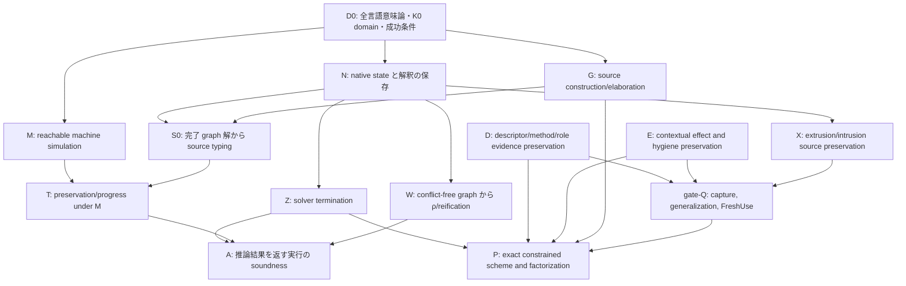

# Yulang Simple-sub 拡張：全体証明への移行監査・証明設計
## 全言語意味論基準版・R345更新（2026-10-23）

| 項目 | 固定値 |
|---|---|
| 対象 | `momota1029/yulang`、branch `research/simple-sub-intrusion` |
| 全言語意味論 | [`yulang-whole-language-semantics-ja.tex`](yulang-whole-language-semantics-ja.tex)、SHA-256 `6246e7dc179a795b372603eac8cd64bf783ba69e9a4a733bcfc012ebd6869612` |
| 移行監査の入力原文 | [Simple-sub 全体証明監査](Yulang%20Simple-sub%20%E6%8B%A1%E5%BC%B5%EF%BC%9A%E5%85%A8%E4%BD%93%E8%A8%BC%E6%98%8E%E3%81%B8%E3%81%AE%E7%A7%BB%E8%A1%8C%E7%9B%A3%E6%9F%BB%E3%83%BB%E8%A8%BC%E6%98%8E%E8%A8%AD%E8%A8%88.md)、SHA-256 `b720fc938423bea1b677f7121653e2452b0fb0b9bb2919e9d38c7fccbee64895` |
| 前版の意味論 crosswalk | `docs/Yulang Simple-sub 拡張：全体証明への移行監査・証明設計（全言語意味論整合版）.md`、SHA-256 `bea755595302d5b98fb1880fb89b505ad783a6e428c639aae6734b167df86d65` |
| 証明記録の統合点 | `a5edc8ee7`（2026-10-23、R345 bounded PASS まで）。source 監査基準 `18d10b95942fbb8775b92542884e5a55860670bc` 以降、`crates`、`tools/inference-playground`、`spec` に差分はない。R345 はその source 契約に対する K0 の限定証明を追加した。 |

この版は、監査の証明目標を全言語意味論の型付き elaboration・実行関係・選択算法・Q1–Q8 に沿って組み直し、R345 までの証拠を反映する。監査原文、意味論 TeX、前版 crosswalk は入力・履歴としてそのまま保持する。ここでは仕様上の目標、実装で観測した事実、限定証明、未解決 gate を分ける。compiler、test、expected output は変更していない。

## 1. 到達点と定理の境界

### 1.1 意味論文書が固定する目標

全体の対象は Simple-sub 型推論の小言語だけではない。省略可能 record、method/role selection、effect と handler、State と再開、全 IR と pattern、module/declaration、生成コード、primitive を含む Yulang 全言語である。意味論文書は次を一つの仕様として定める。

1. source の各 checking 境界で単一の `A <: B` 判定を行い、具体変換がある場合はその境界に実行可能な証拠 `k` を得る。
2. method selection、role resolution、関連型、値参照 SCC、一般化を一つの saturation driver に接続する。選択順序を含む Oracle 方針と、提案される順序独立な改善を同一視しない。
3. effect を family 名の集合だけに還元せず、source contribution、typed path、owner、受信 view、動的 request、handler 寿命、grant、返却値の latent effect を同じ割当ての下で解釈する。
4. 全 source を境界証拠、遅延、選択先、store/frame、failure を明示した typed core へ elaboration し、その core の意味論と現行 compiler/runtime の対応を別に証明する。

この意味論文書自体も、全言語健全性・完全性・principality・停止性が完成したという報告ではない。typed core の提案、限定された補題、未完の compiler correspondence を区別している。本監査もこの区別を保つ。

### 1.2 証明状態

| 状態 | この文書での意味 |
|---|---|
| **bounded PASS** | 明記した domain、入力、前提、結論の範囲で独立 review を通過した。親定理の閉鎖を意味しない。 |
| **条件付き** | 数学的な結論は明示した前提の下で成り立つが、より広い source/domain から前提を得る橋が未完。 |
| **source evidence** | 所有コードや記録が構造上の対応を示す。単独では意味保存定理ではない。 |
| **設計** | 意味論、アルゴリズム、または証明の目標を記述する。実装・定理の成立を主張しない。 |
| **OPEN** | 必要な証明・対応・反例判定がまだ閉じていない。 |

単体テスト、候補 solver の `Ok`、空の未解決一覧、有限 prefix の補題は、それだけで graph の充足可能性、公開 scheme の完全性、全言語 soundness、終了性を与えない。

### 1.3 全体定理の形

最終目標は、固定した source semantics、elaboration、choice policy と外部環境契約に対し、accepted source の型付き実行が値・宣言された request/failure・発散のいずれかとなり、内部故障を起こさないこと、さらに推論結果がその source typing を正確に表すことだ。推論器が停止して結果を返すという保証は別途 solver termination を要する。

完成時の意味論関係は raw runtime value の集合だけではない。world `W` と共通割当て `θ` のもとで、有限観測深さ `n` ごとに typed view `Vⁿ_{W,θ}(A)` と computation `Cⁿ_{W,θ}(A, Φ)` を同時に定義する。function の引数、結果、effect、receiver、resumption で別々の `θ` を選ばない。全 finite prefix で正常 return の値/store、外部 request の identity/payload/owner/path、宣言された応答後の suffix、意図された language failure を保存し、internal stuck を排除する。再帰は observable step または guarded unfolding ごとに深さを減らす。

境界 evidence `k : A ↦ B` の意味は、source view を実行可能な target computation へ変換することだ。これは `V(A) ⊆ V(B)` という集合包含を要件にしない。二つの evidence を bind 合成できることと、一回の concrete comparison が推移的であることを区別する。

完成定理は意味論文書の **Q1–Q8** を同じ typing judgement と同じ証拠 witness で満たすまで宣言しない。Simple-sub の論文結果を、Yulang の record view、effect hygiene、selection、intrusion、runtime adapter まで自動的に拡張しない。

意味論の observable result は `Ret(v,S)`、`Req(o,a,κ,S)`、明示された `Fail(r,S)`、および発散の有限 prefix である。accepted source に許された request/failure と発散は健全性違反ではない。対象から排除するのは内部 stuck、未束縛 local、未宣言 runtime failure であり、solver termination と program termination は別定理にする。

状態 `S=(η,μ,𝒜,ℒ)` は lexical environment、live store、順序付き invocation/handler/frame、値の typed path/origin を同時に持つ。bind は request の継続へ残りの計算を合成し、resume は応答と resume 時点の状態を受け取る。handler が捕捉する local State frame は複数 resume で枝ごとに snapshot-copy しうるが、捕捉範囲外の cell は共有される。State scope identity を保ったまま frame occurrence を扱い、全 heap を一律 copy/share とはしない。computed roots は source 順に一度実行して値を環境へ保存する。

## 2. 意味論の共通基盤

### 2.1 source typing、typed core、compiler 対応を分ける

source の型付けは native solver の実装を前提に定義しない。synthesis/checking と elaboration を次の形で独立に定める。

```text
Γ ⊢ e ⇒ (A, Φ) ↦ M ; C
Γ ⊢ e ⇐ (B, Ψ) ↦ N ; C
Δ ⊢ A <: B ↦ k
Δ; Γ; Σ ⊢ v : A
Δ; Γ; Σ ⊢ M : A ! Φ
```

`M` には通常の値・計算に加え、`Delay`/`Force`、`Invoke`、pattern/case、shallow `handle`、`adapt_k`、`get`/`set` を明示する。runtime は型推論器へ戻らない。source specification、typed elaboration、compiler correspondence、metatheorem は別の proof obligation である。

意味論文書の型代数は base/nominal、union/intersection、regular recursion、tuple、presence を持つ record、polyvariant、thunk `U(E,A)`、Function `F(A,E⁻,E⁺,B;π,m)` を含む。scheme は root type だけでなく quantified rows、role/associated predicates、recursive bounds、boundary/effect templates、evidence holes と依存辺を保持する。Function の `π` と `m` は source annotation と formal constructor が決める属性であり、solver の後段で shape から推測しない。

値型の代数では `Any` を top `⊤`、`Never` を bottom `⊥` として扱い、`Unknown` は未解決のメタ情報として分離する。`Unknown` を top/bottom や optional field の不在・存在へ読み替えない。

### 2.2 一つの適合判定と経路証拠

境界ごとの具体比較 `A <: B ↦ k` は、型値集合への包含と同義ではない。optional record の concrete comparison は非推移的で、同じ endpoints でも direct adaptation と中間 view を通る adaptation では結果が異なる場合がある。したがって:

- 中間型を自由に挿入する一般 subsumption 規則を置かない。
- 証拠の実行を通常の計算合成で bind できることから、`<:` 自体の推移性を導かない。
- record/map の存在証拠、隠された field、optional payload、評価順、source boundary identity を evidence に残す。
- conversion evidence を省略する最適化は、同じ可視 view と観測を保つ refinement proof を要する。

この差は単なる抽象上の注意ではない。`A={foo?:string}`、`B={}`、`C={foo?:int}` では `A <: B` と `B <: C` が成立しても、直接比較 `A <: C` は present payload の `string <: int` を要して失敗する。また `{foo=1}` を `C` へ直接適応すれば `foo` を保持する一方、`B` を経由すると visible view から消える。よって中間 view と evidence を消した endpoint-only な cast 合成は、型付けと観測の両方を誤る。

record は backing object の全 field ではなく、境界ごとの可視 view として読む。optional field は absent/present(payload) の二分岐を持つ。target required field には source required field または authentic presence evidence が必要であり、共通 optional field も present branch の payload comparison を免れない。target にない source field は view から落とし、後の境界で再発見しない。`RecMap` は field 順、presence、子変換、境界 identity を保持する。default は field が欠けた場合だけ source 順に実行する。record spread の head/tail は別 constructor として保ち、unordered row union に潰さない。nominal cast は宣言された直接 pair の候補を選び、暗黙の multi-hop 探索をしない。

したがって Q2 は単なる concrete subtype decision の一致ではない。inference propagation、specialization、runtime boundary が同じ presence/view/evidence を実現することを要する。record fast path が値をそのまま返す場合も target-visible mask を保つ証明が必要になる。

### 2.3 値と計算、遅延 call と入口

関数 interface は最低限 `(argument value, argument effect, return effect, return value)` を共有する。意味論文書の拡張表現 `F(A,E⁻,E⁺,B; π,m)` では、`π` は明示契約 profile、`m` は source から定まる Value/Computation entry role を保持する。期待型の shape だけで entry role を推測しない。

Application は callee の評価後に引数 code と caller lexical environment を一つの `Delay` に保持する。Value entry はその carrier を force し、得た同じ値/viewを formal cell に束縛する。Computation entry は carrier を本体へ渡し、未 force なら引数 code は実行されない。受領、入口、native call、本体、result consumer、result adaptation の順序を保存する。

Function 比較は value variance だけでなく、同一割当て・同一受信関係下の complete Call を比較する。effect 二ポートを独立に選ばず、引数で実行した effect が返却側へ流れる経路、latent result effect、handler/owner を同じ witness に置く。

### 2.4 effect、view、owner、State

次の identity を別に保つ: effect family と invariant arguments、operation、動的 request occurrence、受信 invocation、annotation boundary、handler activation、State instance。typed view packet `(value, type-position, profile, conditions/dependencies, origin)` は source からの path/owner 対応を保つ。support family が一致するだけでは対応を作り直さない。

- permission/allowance は実際の contribution や provider 到達性ではない。
- `unknown`/opaque view は negative evidence ではない。
- callback の省略 effect と明示 wildcard、concrete row、computation formal を区別する。
- handler は shallow。raw resumption は handler を自動再設置せず、resume 時の状態と store/frame 所有を保つ。
- State reference は同じ invariant cell を参照する。複数 resume 時の frame 複製/共有は handler が捕捉した範囲で決まる。
- effect safety の保守的過大近似だけでは、effect method の選択が互換であると結論しない。lookup が読む observation の一致または選択不変性も示す。

effect row の表示だけから permission と実流入を推定しない。

| source form | 意味論上保持するもの |
|---|---|
| negative concrete row `[C]` | 開いた incoming interface と、その受信 boundary の permission。`C` を実際の contribution とみなさない。 |
| positive closed `[C]` | 現在および将来の concrete lower に適用する上界 filter。 |
| row tail | 同じ tail variable と依存義務。表示から隠れても削除しない。 |
| 省略 callback effect | 推論 callback effect に対する fresh protection。具体 family grant は作らない。 |
| 明示 callback result `[_]` | open interface。省略時の Empty protection を追加しない。 |
| explicit computation formal | carrier を保持する computation entry と open handling boundary。callback wildcard と統合しない。 |
| whole-type wildcard | 型構造を推論するが、entry role は source formal の構文から決める。 |

handler が contribution を除けるのは、same request exposure に対する authentic boundary/path、active owner、対象 operation、型引数、coverage と保護証拠がそろう範囲だけである。grant と handler owner は一致し、別 invocation へ持ち越さない。callback body 自身の通常 handler を一律に封じる意味にはしない。受信 invocation が終わっても、返された closure の latent effect は残る。

shallow Catch は operation arm へ raw continuation を渡し、自動で同じ handler を再設置しない。scrutinee effect `ε`、value-arm effect `ε_v`、operation-arm effect `ε_o` を分け、失敗しうる pattern/default/guard で既に起きた effect も含める。安全側の上界は概ね

```text
ε_out ⊇ residual_h(ε) ∪ ε_v ∪ ⋃_o ε_o
```

で、削除可能なのは coverage/owner/path が証明された immediate contribution に限る。resume 後の suffix は scrutinee contract に含め、返却 closure の latent slots を消さない。実行時 `NoMatch`/`MatchFailure` と内部 `UnboundLocal`/stuck は別 outcome とする。

### 2.5 型推論 driver、選択、全 syntax

source typing は native solver の状態を前提にせず、synthesis/checking と typed elaboration を独立に置く。checking が作るのは構文上その場にある一つの境界義務であり、任意の中間型を挟む一般 subsumption はない。したがって direct な `A <: C` が失敗する source に、別の `B` を挿入して成功扱いする証明は認めない。

全対象は意味論文書の 13 expression constructor、11 pattern constructor、3 statement constructor と、definition/module/import、nominal・role・impl・operation・cast 宣言、generated declaration、runtime roots、primitive/host contract である。各 constructor は source 順、binder identity、Value/Computation entry、immediate/latent effect、許された failure、境界 evidence を typed core へ渡す。parser が構文を読める事実は annotation builder や runtime がその意味を実装した証拠ではない。

expression owner は `Lit`, `PrimitiveOp`, `Var`, `App`, `RefSet`, `Lambda`, `Tuple`, `Record`, `PolyVariant`, `Select`, `Case`, `Catch`, `Block`。pattern は `Wild`, `Lit`, `Var`, `Tuple`, `List`, `Record`, `PolyVariant`, `Con`, `Ref`, `As`, `Or`。statement は `Let`, `Expr`, `Module`。if/no-else、演算子、string/rule/Yumark、for/sub/return、error helper、act copy などの surface form は lowering/generated item として同じ typing/runtime contract を通る。no-else if は then の値を捨てて unit を返す bool case として扱う。

method/role 選択は固定した Oracle policy として記述する。候補 identity と可視性、local/global unique lookup、stored-order の first-success、raw lower/upper の直接義務を保つ。effect receiver を先に probe し、method upper の関数引数 effect/value、intersection、stack などを定めた順で調べる。role は主型と全 role の raw bounds を使い、polarity/taint を検査して一意の head を選ぶ。関連型/prerequisite は親候補を選んだ後に代入し、失敗した親を次候補へ差し替えない。追加義務は raw graph に戻して再飽和し、新しい compact view で未解決 selection を再試行する。fallback は ready role を順序づけて処理し、role fallback の後に具体 probe、最後に field fallback を行う。選択後は実際の value-use edge のみを SCC に加え、一般化へ進む。未解決 selection を scheme に残さず、確定済み選択を後の情報で選び直さない。batch 化や順序独立化は、基準 policy との別の refinement proof が要る。

OR pattern は独立した束縛上の既知問題を持つ。成功した一方の枝にない binder を body に見せない修正は、両枝の共通 binder を merge する明示的な受理変更として扱う。record/effect の意味を保つ証明だけではこの問題を閉じない。以上は意味論の仕様と必要な接合であり、全 constructor の compiler correspondence が既に完成したという記述ではない。

## 3. 全言語意味論と監査 gate の対応

| 全言語意味論の領域 | 監査側の gate | 閉じるべき橋 |
|---|---|---|
| 全 syntax、declaration、module、parser と elaboration（意味論 §§1–2、IR/pattern、付録） | G / source half of C / Q1 | 全 source/生成 declaration の binder、identity、順序、entry role、診断、typed-core constructor 対応。parser-only を実装済み typing とみなさない。 |
| 単一境界 resolver、optional record、nominal cast（§§3–4） | G / N / Q2 | 同じ concrete resolver の soundness/completeness、presence、`RecMap`、cast identity。optional comparison の非推移性と path dependence を保存。 |
| 型 variable flow、ordinary/effect routing（§5） | G / N / E / Q3 | producer/consumer endpoint と boundary の authentic route を全て保持し、false route/消失 route を排除。固定 graph theorem を source wiring correspondence と混同しない。 |
| 全 IR constructor、pattern、branch binding（§6） | G / C / Q1 | source 順、全 branch、default/guard effect、成功 branch environment、`OR` binder merge、許された `MatchFailure` を構成する。 |
| methods、roles、associated types、selection lifecycle（§7） | D / N / Q4 | Oracle の candidate identity/visibility/order、direct endpoint obligation、selection evidence、actual value-use edge、post-selection resaturation を保存。batch improvement は baseline algorithm との別証明を要する。 |
| effect/hygiene/Call/shallow catch/transport（§8） | E / C / D / Q2–Q4, Q6 | contribution、owner/path、same-`ρ` Function ports、raw continuation、arm effect、adapter、handler lifetime の一体的解釈。 |
| value restriction、scheme、SCC、extrusion/intrusion（§9） | X / gate-Q (scheme) / N / Q5 | static dependency closure、同一 FreshUse、actual value-reference SCC、actual parent/copy、many-to-one intrusion の source semantics 保存。 |
| values/computations/world と全体定理（§10–11） | M / S / W / Z / P / Q5–Q8 | finite-prefix logical relation、same world/`θ`、typed result/request/failure/resumption、graph witness/reification、停止性、constrained scheme factorization。 |
| implementation gaps、grammar、primitive contracts（§12 と付録） | G / M / Q1 / Q6 / Q7 | record fast path、optional presence、full Call, hygiene pruning, method scheduling, OR binder, parser gaps, host/native contract, explicit failure semantics。 |

ここで **gate-Q (scheme)** は監査の generalize/instantiation gate、**Q1–Q8** は全言語意味論の接合条件を指す。記号が似ていても同一 gate ではない。

監査原文の九つの親 gate は G/N/X/Q/E/C/Z/S/P のまま保つ。ここでは実作業の境界を明確にするため、M を runtime supplier、W を S0 の model/reification supplier、D を descriptor/selection subgate として図に分けた。M/W/D を追加の親 theorem として数えない。

意味論文書の Q1–Q8 を工程上、以下のように読む。

1. **Q1 — source coverage/elaboration:** 全 expression、pattern、statement、declaration、module、generated item に正確な typed-core rule または明示診断がある。
2. **Q2 — boundary evidence:** concrete resolver が record/nominal/Function を含む全境界に正しい conversion/receipt evidence を作る。
3. **Q3 — wiring:** ordinary flow、effect replay、row/stack routing が source 由来の端点をちょうど覆う。
4. **Q4 — choices:** method/role/associated-type lookup と値参照 graph、effect observation、selection policy が基準動作に対応する。
5. **Q5 — schemes and scope:** capture/generalize/prune/instantiate、extrusion、intrusion が shared environment/store/latent boundary evidence を保つ。
6. **Q6 — execution:** primitive、host operation、State、adapter、optimization を含む runtime が同じ typed execution を実現する。
7. **Q7 — solver bound:** fixed regular graph 等の明示範囲で停止性または厳密な失敗条件を示す。resource timeout を success/completeness に数えない。
8. **Q8 — inference completeness/principality:** constraints、evidence holes、elaboration、choices、scheme factorization を双方向に対応づける。

## 4. 依存グラフと証明 gate



- `G` と `N` は別の証明である。source rule が要求する義務と native admission/replay が扱う義務を同一視しない。
- `S0` は **source typing implication** で、machine simulation を前提に含めない。
- `S0 + M` から初めて reachable runtime preservation/progress の合成へ進む。
- `W` は「conflict がない」から実際の `ρ` と reification witness を構成する。これは native solution preservation `N` と別である。
- `Z` は solver の正常終了を与える。program evaluation の termination は与えない。
- `P` は表示された root type の比較ではない。一つの constrained scheme、elaboration、boundary evidence、choice sequence に対する source observation の因子分解である。

共通不変量は source owner/occurrence、row kind/representative/lineage、solution relation、pending/processing/completed work、generic/shared scope、全 field/Function ports の一括 FreshUse、descriptor prerequisite、actual runtime handle/environment/Delay/owner/view、公開 graph と live graph の対応を含む。個別テストを親定理の代替にせず、各証明をこの不変量の instance として整理する。

## 5. K0 の厳密な入口と限定結果

### 5.1 Domain

最初の証明 fragment は製品要件を縮小しない工程上の入口である。`ValidK0(s)` は authentic ordinary candidate の単一・非再帰 Definition root であり、root annotation/where clause、module/import/他定義依存を持たない。許可する構文は literal、包含 lambda の parameter に解決する Name、annotation なしの単純 Value Lambda、Apply、else 付き If、Group、binding-free Block/StatementBlock。literal spelling は decoder 成功が構文で確認できる範囲に限る。

interpolation、hidden operator lowering、Sequence の独自規則、local binding/let、record/default、tuple/variant/case、Comp、operation/catch/resume、role/member/FieldTail、module/import は K0 の外に置く。これらは後続 gate と全体目標に残る。K0 の HIR domain が認めない standalone `DecodedString` root を追加しない。R343 reviewer は、実際の `DecodedString` constructor が interpolation owner の下にあるため、この境界が audit §4.1 と整合すると確認した。

### 5.2 K0 typing と native state

Value/Effect sort、正負 occurrence、Function 四ポート、row representative、level/non_generic、relation/context、work state、source occurrence/provenance を保持する。有限 K0 source だから有限単純型で必ず解けるとは仮定しない。最初の S0 は有限 reification witness を明示し、recursive regular-type model、existence、solver termination を分離する。

K0 Apply source rule は独立に、callee function type、argument value/effect、return effect、result type と enclosing application effect を結ぶ。native Apply demand と同じ occurrence/子 endpoint をもつことは G の帰納法で示す。四ポートの順序は `(A, E_A, K, R)` であり、`K` は Function の return/invocation-effect port、callee effect `E_F` や application effect `E` とは別である。

### 5.3 L0、F、R-set の正確な位置

- **L0:** K0 ordinary source action 内の新規 row level が 1 のままで、高 level extrusion copy とそれに由来する intrusion が発生しないという bounded 構築補題。通常 capture/export の複写、cyclic bounds、停止性までは含めない。
- **F:** successful FreshUse における同時 row map と構造項再構成の bounded theorem。これは selected input graph と成功した prepare に関する補題で、source scope partition、restoration、capture completeness、scheme completeness ではない。
- **R-set:** `required_roles` union helper の、duplicate-free input の下での集合和補題。異なる context/instance を同じ述語で読む正当性や downstream consumer の source/native 保存は別 gate。
- **local_grant:** `Receiving::local_grant` の constructor 前提下の native query/witness 同値と停止性を証明する限定補題。source contribution が全て witness を持つこと、false が source 非保護を意味すること、effect residual の完全性を示さない。
- **R345:** R336 L0 / R337 J のもとで、authentic ordinary K0 の初期 source/replay/Function lifecycle にある initial/current/designated/processing/FunctionPort retirement の bounded same-row-set preservation。全 pair の発行・消費、全 N、cache/fiber coverage、source constraint completeness は含めない。

### 5.4 S0 と machine 合成

受理済み S0 の形は次で固定する。

```text
ValidK0(s)
∧ NativeComplete₀(s,S)
∧ ρ ⊨ H(S)
∧ Reifiable₀(ρ)
⇒ ∅ ⊢₀ s : ρ(v_s) ! ρ(ε_s)
```

`NativeComplete₀` は collection/admission 完了、対象 work の閉鎖、typing conflict と対象 pending obligation の不存在を表す。`candidate.unresolved().is_empty()` とは定義しない。`ρ ⊨ H(S)` は source typing とは独立した代数的 graph solution。`Reifiable₀` は値・effect assignment の代数的な K0 型表示条件で、source typing 導出・closure realization・実行成功を含まない。

ここでの `H(S)` は、K0 の独立した代数的制約解釈である。全言語意味論の world-indexed `Vⁿ_{W,θ}` / `Cⁿ_{W,θ}`、境界 adapter `k`、source effect contribution の解釈と同じものではない。N/D2 の retention はその全体意味論への接続を仮定せず、接続は Q2–Q8 と各 compiler-correspondence gate に残す。optional concrete comparison に preorder の推移性を使うこともない。

R341 はこの source-typing implication を、元の四 premises のまま bounded に受理された。R340 の S0/S0+M 混同は source typing 側から除外され、runtime simulation/falsifier は別の合成へ置かれた。S0 だけで runtime preservation/progress と呼ばない。

同じ HIR/candidate の `RuntimeProgram` が実際に構築され、selected-definition execution に入った後は、R343 が reachable K0 state/frame の typed preservation と semantic `Unavailable` 排除を bounded に受理した。budget pause は resumable state、checked identity exhaustion は stopped refusal として分ける。これは construction success、graph solution existence、program termination、host OOM 保護を与えない。

## 6. 現在受理された source/native 証拠

| 記録 | bounded disposition | 含意しないこと |
|---|---|---|
| R340 Apply continuation | authentic Apply handoff、prefix/owner、whole Delay と argument-return identity を既存 premises 下で確認 | full C/M、source realization supplier、termination |
| R341 source retention / S0 | root Link、K0 constructor rows、sort-preserving transport、元の四-premise S0 を review 後受理 | full N/cache、machine theorem の S0 への混入、全 source typing |
| R342 value/environment | K0 の actual finite return 時の canonical form、actual handle/capture/environment、same-value binding を受理 | return existence、result/future/effect 完全解釈 |
| R343 machine step | authentic reachable K0 state/frame/step、actual handle/view/owner、budget/refusal 分離を受理 | full M、F1/FK1、arbitrary future/foreign continuation、termination |
| R344 Call | one-`ρ`/one-handle joint prefix、restricted reverse Value-entry、actual return 時の same-result typing、symbolic effect credits、既存 K0 continuation preservation を受理 | original complete receiver/result/future/effect supplier、full C/M、A/B |
| R345 initial drain | L0/J のもとで initial/current/designated/processing/FunctionPort retirement の same-row-set `Sol(H_after)=Sol(H_before)` を bounded PASS | full N/cache/temporal/fiber coverage、全 source constraint completeness、W/Z/S0/C/M/P、A/B/catalog/production |

R344 の証明は D1 由来の origin certificate を実際の `ValueHandle` で index し、allocation→lookup/capture→ValueEntry→forward/return で同じ derivation を保持する。一般の existential `TypedVal₀` canonical formだけを `ρ`-aligned endpoint typing とみなさない。独立 reviewer は全 27 個の artifact/dependency/source pins を確認し、blocking/major/minor finding なしとした。

R344 が残した最初の意味論 supplier は receiver-entry handoff の
`PendingCallSupplier::ReceiverDispatchAndCompleteResultFutureInterfaces`。同じ native record `n`、同じ `ρ`、同じ actual provider/carrier/result に対する original complete receiving interface と output-dependent future/effect/continuation obligations を構成し、ValueEntry/ReceiverReturn へ運ぶ必要がある。`NativeInterface` の retained record は意味論 consumer ではなく、`Receiving::matches_value` の handle equality は complete view certificate ではない。広い `ArgumentReifyAndWholeCarrier` も OPEN。

R344 の effect credit は `E_F ⊆ E`、`E_A ⊆ E_Ac ⊆ E_Rc ⊆ K ⊆ E`、`E_Bc ⊆ E_Rc ⊆ K ⊆ E` という symbolic inclusion の範囲である。空の実行 event trace から symbolic `K` を empty としない。現行 K0 future preservation は既存 reachable continuation に限り、意味論文書の任意 world extension/全 future quantifier を供給しない。

R345 は、保存済みの同じ論理義務を queue/frame/ack/processing/FunctionPort の各管理遷移で失わないことを示した。source admission は `H_after = H_before ∪ {φ(q)}` のままで、retirement の同値保存とは別である。証明は R339 の independent algebraic `H=B∪Q∪P∪R∪D` を使い、全体意味論の `Vⁿ_{W,θ}` / `Cⁿ_{W,θ}` や境界 evidence `k` を証明解釈へ含めない。次に残る N は、必要なすべての source-derived opposite-bound/fiber comparison が実際に生成され消費されるかを調べる coverage obligationであり、発行済み義務の退役保存とは異なる。[R345 proof](../notes/theory/2026-10-23-r345-k0-initial-drain-preservation.md) · [R345 outcome](../tasks/agent-loop/sprints/r345-k0-initial-drain-preservation-20261023-outcome.md)

## 7. 全 gate の精密な statement

### G — source generation/elaboration（Q1、部分的に Q2–Q3）

**G-sound:** authentic source rule による独立導出と、完了済み生成 graph の充足可能な `ρ` から `ρ` に沿う source typing と typed-core elaboration を構成する。native action の存在を typing premise にしない。

**G-complete:** 固定 typed-core/elaboration と boundary choices を持つ任意の合法 source typing から、outer anchors を保つ生成変数割当て、全 generated obligations、evidence holes の充足を構成する。parser が読めるが annotation builder/runtime が未対応の構文は typed implementation 完了とみなさず、明示的 unsupported/diagnostic と意図された構文拡張を分ける。

### N — native state/solution preservation（Q2–Q5）

row 集合を固定する single propagation step では、well-formed state と正しい work invariant のもとで `Sol(H(S')) = Sol(H(S))` を示す。source admission は新義務の追加なので同値保存ではなく、`H_after = H_before ∪ {q}` に対応させる。新 row allocation を含むときは新変数射影を明示する。

pending/processing/completed、RelationId/generation、cache hit の循環根拠、Function child 分解、mutation/replay の temporal coverage、raw/canonical fiber を扱う。optional concrete relation に preorder の推移性を使わない。R345 は既存義務の initial-drain retirement family を閉じた。残る coverage は、source が要求する全 opposite-bound / fiber pair が生成されること、その pair が正しい relation/context で drain に到達すること、cache shortcut と completion が証拠を消さないことを問う。未発行 interaction があるというだけで compiler defect と結論せず、既存 theory から含意されるか、生成すべき source obligation なのに欠けるかを分ける。

### X — extrusion/intrusion source preservation（Q5）

- **X-extrude:** authentic high-level source occurrence と入口 WF のもとで、polarized copy/source link が対象 scope に関する解を保ち、一回の操作が有限であることを示す。visit 中に先行 mutation を見る prefix-dependent behavior を含める。
- **X-quotient:** equality `a=b` quotient がその equality を満たす旧解と新解の間に対応を持つことを示す。これは equality 選択の source 妥当性ではない。
- **X-intrusion-source:** source Value-reference SCC が選ぶ actual parent/copy equality の下で、source が観測する型付け、shared anchor、joint evidence family が保存されることを示す。type-bound SCC、同じ印字型、pointwise 固定だけでは済ませない。

### gate-Q — capture/generalization/FreshUse/restoration（Q5）

scheme は型表示に加えて quantified variables、role predicates、recursive bounds、effect/boundary templates、evidence holes、依存辺を保持する。量化集合は source scope、value/computation restriction、static dependency closure、shared store/capture/environment に従う。

各 use/clone occurrence と quantified binder の対から一つの sort-preserving injective map を作り、型・四 port・guard・profile・証拠を一括して写す。outer anchors、cell、captured dynamic identities は変えない。R344 の handle-origin certificate とこの scheme-level scope proof は別義務。

restoration は論理 bound pair に関する temporal coverage とし、物理 slot を一回走査したことだけで閉じない。intrusion による reopen/generation、non_generic、EffectOperand、shared bound、external role evidence を入れる。

### E — contextual effect/hygiene preservation（Q2–Q6）

source contribution と runtime event/route/protection の間に constructor-derived typed path、owner、profile、family argument の同一対応を与え、同じ `ρ` と world で外部 trace が inferred effect contract に含まれることを示す。permission は受信可能性や effect occurrence の証拠ではない。`unknown` coverage は residual に残す。

Complete Call と shallow handler/resumption を通じ、argument entry effect、callee call effect、result latent effect、handler arm/default/guard effects、raw continuation suffix を一つの calculation に合成する。全 tuple/record/function/thunk/cell/State transport で origin/lifetime を保つ。保守的核の safety と Oracle-equivalent effect-method lookup は別の定理である。

### D — descriptor/method/role selection preservation（Q4）

source declaration/use identity、scope visibility、raw demand、associated equality、候補順序、selected member、actual value-use edge、solver re-saturation、runtime dictionary/member identityを同じ selection evidence で結ぶ。

R330–R335 の Button/FieldTail 記録は source-qualified fixture・局所集合補題・実装変更後の観測を与えるが、一般 descriptor preservation、全 lifecycle、公開入口から publication、full role conjunction または method choice completeness ではない。R-set、R1–R4 と後段 consumer は引き続き該当 gate に接続する。Oracle の first-success/逐次 fallback と batch 改良の同値は別 proof。

### C/M — Call と実行意味論（Q2–Q6）

Forward direction は authentic Apply の independent derivation と reachable typed runtime configurationから始める。実際に callee return が起きて entry に進んだ finite prefix の中で、同一 closure handle/capture、whole Delay/caller environment、invocation/owner、received value/view、同一 result/future/effect witness を保つ。normal return は条件付き。逆向きは正しく解釈された native Function demand と同じ reachable runtime realizationから所定 entry・result・effect continuation へ進む。

R344 が閉じたのは ordinary selected-definition K0 の restricted Value-entry prefix と existing K0 future の preservation。Comp、foreign continuation、arbitrary carrier、complete result/future supplier、任意 future call quantifier は閉じていない。Call termination は前提にも結論にも置かない。Result closure を作っただけで latent effect/future obligation を消さない。

### Z — solver termination/resource semantics（Q7）

fixed K0 source に対する idealized transition が completed result または意味のある conflict に有限で到達することを目標にする。row/event/context carrier の有限性と administrative measure を分けて示す。queue length だけを減少量にしない。resource timeout/identity refusal を成功・完全性として数えない。program の発散は許され、Z と別である。

### S / W — source typing と solution construction（Q2–Q7）

**S0** は §5.4 の graph solution から source typing。machine theoremを含めない。**M composition** は same typed program の selected-definition reachable execution の preservation/progress。`ValidK0`、source/native `NativeComplete₀`、`ρ ⊨ H(S)`、`Reifiable₀(ρ)` の四前提を勝手に増やさない。

**W** は conflict-free saturated graph と source obligations から actual `ρ`、各 row assignment、recursive/cyclic shape が許される場合の reification witness を作る。source typingやmachine successを checker premise に含めず、W 自体の soundness を証明する。W によって S0 の model witness premiseを除く。

### P — constrained scheme completeness/principality（Q8）

対象は印字 root type ではなく `(quantified variables, C, T, elaboration with boundary evidence holes, selection evidence δ)` の constrained presentation。固定 elaboration/choice の下で、合法な source typing が一つの整合した substitution/evidence と許された wideningを通って factorし、全合法 instance が正しいことを双方向に示す。

全合法 method/cast choices まで主張する場合は choice completeness/coherence を追加する。optional record path dependenceを無視した proof irrelevance、union renderer の能力を超える公開表現、Simple-sub 原論文の外挿をしない。

## 8. 全構文へ広げるときの追加責務

K0 の次の fragment を一度に追加しない。各 syntax family に independent source rule、typed core、evidence、runtime correspondence、failure/request contract を追加する。

| 次の領域 | 保持する意味 | 主な gate |
|---|---|---|
| pure nonrecursive let | Value/Computation と FetchValue/FetchComputation、value restriction、computed result の一回評価、capture/static dependencies | G, N, gate-Q, X |
| tuple/list/nominal data/record | source order、field existence/presence、visible view、RecordMap、spread head/tail、default を欠損時だけ評価、nominal identity/cast evidence | G, N, M, E |
| Variant/Case/pattern | tag/arity/payload、順序付き arm、guard/default effect、成功枝だけの lexical environment、許された MatchFailure | G, M, E |
| methods/roles/associated type | declaration scope/visibility、raw role bounds と direct cross-endpoint duties、候補順、selected definition use edge、SCC/resaturation | D, N, gate-Q, P |
| operations/catch/resume | exact operation identity、payload/response、raw continuation、shallow handler、multi-resume state/frame ownership、future effect | C/M, E, Q6 |
| mutable reference/State | invariant cell type、scope/frame identity、captured vs shared store、fork policy | M, E, gate-Q |
| modules/import/realm/band | module closure、resolved names, visibility, runtime roots/source order, test-vs-normal root | G, D, Q1, Q6 |
| declarations/generated code/primitives | nominal owner/constructor, all impl universal obligations, error helpers, operators, parser/Yumark, primitive and host failure contracts | G, D, M, Q1, Q6 |
| parser/annotation grammar | parser acceptance、annotation builder、checker の実装範囲、明示診断を個別に対応づける。forall/record annotation/case annotation/parser DSL の parser-only 境界を保持 | G, Q1 |
| primitive/host contract | payload/response、部分失敗、index/range/overflow/string semantics、外部 request と world 更新を固定。`Any` escape にしない | M, E, Q6 |

OR pattern binder repairは意図された互換性変更として独立評価する。成功枝にない binder を body へ公開しない merge rule が必要だが、それを effect hygiene や optional-record 意味論の変更と混同しない。parser-only annotation、未対応 tail spread、部分 primitive、host failure は、全言語対応または明示診断のどちらかを仕様に固定する。

## 9. 実装差分と証拠の扱い

意味論文書が示す主な compiler correspondence 課題は、record fast path の visible view、optional-to-required presence、joint Function comparator、hygiene compaction/liveness、effect-method observation、Oracle selection schedule と batch 改良の同値、OR binder、parser-only grammar と annotation builder の境界、tail spread、全 generated declaration/primitive/host contract である。これらは K0 で省略したから解決済みになるのではなく、当該 feature gate に残る。

R344 source census/proof は `candidate_source::Apply` → `shadow_apply` の retained NativeInterface → D0 Function ports → runtime Callee/ValueEntry/ReceiverReturn の local correspondence を記録する。solver 側の retained record は意味論 consumer ではない。`Receiving::matches_value` は handle identityだけを見る。これは missing supplierを示すのであって、runtime の source defectを立証するものではない。

テスト本文・保存済み run record は特定経路の evidence として扱う。手書き補題・static check・candidate observation を machine proof や general theorem に昇格しない。ここでの改稿作業では code/test/expected output を変更していない。

## 10. 監査結果と次の工程

### 10.1 現時点の disposition

- R341 の conditional S0 source typing、R343 の reachable K0 machine-step preservation、R344 の same-witness K0 Call prefix、R345 の initial-drain obligation retirement はそれぞれ bounded review を通過。
- R340–R345 の結果は、同一 HIR/candidate/`ρ`/runtime program を結びつける条件付き合成の材料となる。S0 source typing と S0+M runtime safety の証明 dependency は分離したまま。
- Full M/C の first missing supplier は original complete receiver/result/future/effect interpretation。R344 はその predicateを前提に挿入していない。
- N の全 pair generation/consumption、cache/temporal/fiber coverage、X-intrusion-source、full capture/restoration、E source contribution/hygiene、D lifecycle、W, Z, P、Q1–Q8 は残る。
- compiler implementation disposition は R345 時点で `NO_SAFE_CODE_SLICE`。全言語意味論に合わせるための実装変更は別の source-qualified obligation と concrete counterexample を要する。

### 10.2 優先順

1. **D2/N all-pair coverage:** 必要な opposite-bound/fiber comparison の source obligation、実際の生成箇所、exact relation/context、drain 消費を全て対応づける。R345 が閉じた retirement 保存と分け、未発行 pair が既存 theory から含意されるかを判定する。
2. W/Z の exact dependency と witness construction、restoration/capture Q、intrusion X を個別 packet として閉じる。
3. C/M を全 Function contract（receipt、entry、native call、result consumer、adaptation、future/effect）へ広げ、E と handler/state semanticsを接続する。
4. D と全 source Q1–Q4を閉じ、Q5–Q8と constrained principal schemeへ進む。

R345 end selector は「既存 bound だけで欠落 interaction が含意される場合もあるため、coverage gap と compiler defect を分ける」ことを指定した。R346 の具体 packet は次 sprint 開始時に dispatcher で依存・pins・資源を再確認して固定する。

### 10.3 完成の判定

以下が全て閉じるまで「全言語推論・意味論の soundness/principality を証明した」と書かない。

1. source syntax/declaration の typed elaboration と diagnostic boundary が完全。
2. 単一 resolver と境界 evidence が concrete record/cast/Functionを含め sound/complete。
3. source wiring、ordinary/effect replay、row/stack、mutation/cache/reopen が source-relevant solutionを保存。
4. method/role/associated choices と lifecycle が要求された Oracle semanticsに対応。
5. value restriction、captured dependency、scheme、extrusion/intrusion、published graphが全合法 typing observationを保つ。
6. primitive/host/State/adapters/optimizations の runtime correspondence、Callとshallow handler/resumption/future contractが成立。
7. fixed domain のsolver terminationまたは正確な拒否条件が成立。
8. 一つの constrained schemeが全合法 typing/evidence/choiceを双方向に表す。

この文書は audit 原文の quantifier と original Yulang2/Simple-sub A/B goalを取り下げない。K0 は順序付けであって、新しい製品 scopeではない。

## 11. bounded FreshUse / local-grant 証明の位置

監査原文 §§8, 11 の手書き証明を、全体意味論の theorem と取り違えずに保持する。これらは typed scheme/effect evidence の局所 supplier として使えるが、source から supplier 前提が満たされることは別 gate に残る。

### 11.1 FreshUse の同時置換 F

成功して `prepare_candidate_fresh_use` が `Ok(FreshUse)` を返した時点を対象にする。ordinary mode、EffectOperand なし、非自明 context/attachment/scope payload と source role/FieldTail obligation なし、代表関係が安定した有限 captured graph に対し、captured row の現在代表 class から live row への単射 map `f` がある。全 occurrence は同じ canonical class image を使い、polarity・Function 四 port・Tuple 順・Record field name/optional bit・Variant tag/arity/payload 順を保持する。新規割当て rows への一貫した改名で、固定した有限制約集合の解は対応する。

二回の成功 prepare の fresh allocation 集合の非交差は、同一 session branch、配列 rollback/truncation なしという条件付きである。これは scheme の generic eligibility を決めない。source scope partition、capture completeness、EffectOperand/context/role evidence、bound restoration、intrusion、full scheme specialization、principality は含まない。構造 graph の循環 bounds は許すが、structural child graph は有限 DAG とする。詳細な前提と帰納証明は[監査原文 §8](Yulang%20Simple-sub%20%E6%8B%A1%E5%BC%B5%EF%BC%9A%E5%85%A8%E4%BD%93%E8%A8%BC%E6%98%8E%E3%81%B8%E3%81%AE%E7%A7%BB%E8%A1%8C%E7%9B%A3%E6%9F%BB%E3%83%BB%E8%A8%BC%E6%98%8E%E8%A8%AD%E8%A8%88.md) にある。

### 11.2 `Receiving::local_grant` の native query 補題

production constructor が作る有限 Receiving state と、query 中に不変な状態に限る。active invocation、同じ source owner の receiving boundary、許可 family、authentic observation、同じ view の receipt、target owner/formal、image-parent path がそろう独立 witness relation を定義すると、native `local_grant` はその witness の存在と同値な boolean を返し、停止する。parent の receiver ID は厳密に減少するため image path は有限で、visited-set は authentic witness を隠さない。

この命題は runtime/native query の正確性であり、source から許された全 contribution が witness を得る source-supply theorem ではない。`false` は source 非保護を意味せず、effect residual の完全性も与えない。詳細は同じ[監査原文 §11](Yulang%20Simple-sub%20%E6%8B%A1%E5%BC%B5%EF%BC%9A%E5%85%A8%E4%BD%93%E8%A8%BC%E6%98%8E%E3%81%B8%E3%81%AE%E7%A7%BB%E8%A1%8C%E7%9B%A3%E6%9F%BB%E3%83%BB%E8%A8%BC%E6%98%8E%E8%A8%AD%E8%A8%88.md) を参照。

### 11.3 L0、R-set、R345

- L0 は K0 ordinary source actions が作る live rows の level が 1 である bounded construction lemma。高 level extrusion/intrusion の出現を除くが、通常 capture/export copy、cyclic bounds、終了性を除かない。
- R-set は `required_roles` の duplicate-free union の集合補題。異なる descriptor context 間の同一性や後段 consumer の正しさを示さない。
- R345 は既存 obligation retirement の bounded N/D2 family。source constraint completeness / pair coverage は次の独立した N gate に残る。

## 12. 再利用時の判定

この監査は、意味論文書が定義する全言語型推論・実行仕様を証明 gate と接続した移行設計であり、full soundness/principality の完了報告ではない。局所的に証明した resolver、transport、FreshUse、native grant、K0 preservation は、それぞれの前提領域でだけ再利用する。source typing、実際の選択、runtime execution、公開 scheme への橋は G/N/X/Q/E/D/C/M/W/Z/P と Q1–Q8 の owner に戻す。

## 参照記録

- [全言語意味論](yulang-whole-language-semantics-ja.tex)
- [原監査・証明設計](Yulang%20Simple-sub%20%E6%8B%A1%E5%BC%B5%EF%BC%9A%E5%85%A8%E4%BD%93%E8%A8%BC%E6%98%8E%E3%81%B8%E3%81%AE%E7%A7%BB%E8%A1%8C%E7%9B%A3%E6%9F%BB%E3%83%BB%E8%A8%BC%E6%98%8E%E8%A8%AD%E8%A8%88.md)
- [R343 outcome](../tasks/agent-loop/sprints/r343-k0-machine-step-safety-20261023-outcome.md)
- [R344 outcome](../tasks/agent-loop/sprints/r344-k0-call-interface-20261023-outcome.md)
- [R344 proof](../notes/theory/2026-10-23-r344-k0-call-interface.md)
- [R345 proof](../notes/theory/2026-10-23-r345-k0-initial-drain-preservation.md)
- [R345 source census](../notes/theory/2026-10-23-r345-k0-initial-drain-source-census.md)
- [R345 outcome](../tasks/agent-loop/sprints/r345-k0-initial-drain-preservation-20261023-outcome.md)
