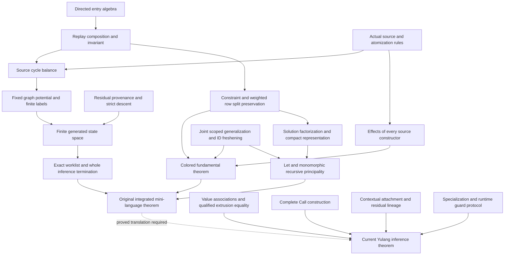

# Oracle inference document and proof audit

Date: 2026-10-12
Status: research audit in progress; no semantic decision or proof promoted
Authority: the user's explicit document-first audit request
Implementation changes and executable inference experiments: excluded

## 1. Initial document catalogue and corpus boundary

[catalogue.tsv](catalogue.tsv) enumerates 645 historical document paths across
the frozen refs in [corpus-refs.tsv](corpus-refs.tsv). At the Oracle anchor
`a58eefc31e22141574b6f20c6a5748151c6d79f1`, 427 remain, including two example
text files; 425 are Markdown, TeX or PDF. Renamed paths are counted separately.
Discovery is not full reading, relevance classification or proof verification.
The TSV marks unknown fields explicitly. Unicode names were enumerated with
Git quoting disabled; the earlier 423-path count omitted four such names.

The boundary includes the anchor's full ancestry, the six later `origin/main`
commits and the legacy inference/level/rescue refs. The September Y3 intrusion
sketch briefly committed to main is comparison material, not Oracle authority.
Neither Oracle worktree contains untracked document candidates. The seven
retained `On main` stashes were also screened read-only: none changes/adds a
document path relative to its base, including available untracked parents.
Missing never-committed drafts and inaccessible/pruned objects remain coverage
limitations; they cannot be supplied by inference behavior. The explicitly
cited external residual-regression memory exists and was consulted at relevant
entries, as an owner report rather than an approval receipt.

The initial core list is below. Dates distinguish document declarations from
exact path creation; a rename's predecessor is recorded separately.

| Document | Date and history | Recorded standing; audit scope |
| --- | --- | --- |
| `spec/2026-05-31-effect-variable-subtractable.md` | May 31 declaration; original June 1; spec promotion June 6; directed-weight revision June 22 | Core spec according to its index; direct user-approval provenance unresolved. Directed weights, subtraction, replay, compact and cleanup. |
| `spec/2026-06-02-role-system.md` | June 2; promoted June 6 | Core interval cross conditions, variance, levels and recursive discharge; direct approval provenance unresolved. |
| `spec/2026-06-04-method-selection.md` | June 4; promoted June 6 | Deferred selection and role resolution; direct approval provenance unresolved. |
| `spec/2026-06-06-invariant-type-sandwich.md` | June 6 | Centerless intervals and elimination; depends on role cross conditions; direct approval provenance unresolved. |
| `spec/2026-06-13-computed-fetch-value-restriction.md` | June 13 | Effectful retrieval, quantification boundary and SCC restrictions; direct approval provenance unresolved. |
| `research/effect-mini-language/colored_weighted_simple_sub_ja.tex` | Added June 21; deleted June 22 | Earlier research draft; directory rules explicitly exclude production-spec authority. |
| `research/effect-mini-language/weighted_effect_subtraction_core_ja.tex` | Added June 21; deleted June 22 | Earlier weighted core draft. |
| `research/effect-mini-language/directed_stack_weight_principal_letrec_ja.tex` | Added June 22; deleted June 22 | Earlier principality/recursion draft. |
| `research/effect-mini-language/directed_stack_weight_principal_letrec_colored_soundness_ja.tex` | Exact ADD `0dd37b900`, June 22; revised; renamed with changes | Colored soundness predecessor; no explicit approval located. |
| `research/effect-mini-language/directed_weight_row_solver_termination_ja.tex` | Declared June 21; exact ADD `fac1aeec8`, June 22; deleted later June 22 | Separate termination draft, recovered from deletion parent. |
| `research/effect-mini-language/directed_stack_weight_letrec_complete_ja.tex` | Declared June 22; exact path ADD/rename `f2c186b3e`, June 22 | Surviving combined research draft. The word “complete” is not verification or approval evidence. Rescue has an alternate revision. |
| `notes/design/2026-06-22-directed-stack-weight-implementation.md` | June 22 | Consequences of the draft; explicitly supersedes conflicting older protect/floor readings. References the predecessor filename. |
| `docs/infer-solver-invariants.md` | June 23; revised July 17 | Working invariant contract, explicitly not a complete proof. |
| `docs/effect-inference-brief.md` | June 23 | Explanatory draft with theorem/projection limitations. |
| `notes/design/2026-08-16-infer-proof-architecture-retrospective.md` | August 16 | User approval is for retrospective analysis, not implementation authority. |

The catalogue also includes the archived May effect seed/detail, June cooccur
and optimization material, July generalization/cache/epoch/row-reduction
designs, and July–August provenance and proof-kernel decisions. Their individual
definitions, approval scopes, supersession and proof statuses remain to be
integrated rather than inferred from their directory or commit author.

## 2. Verification method and authority

Read the documents themselves and recover deleted/renamed versions from Git.
`--follow` identifies lineage, not exact filename creation. Use no-renames ADD
evidence for the latter. Record filename dates, declared dates, author/commit
dates and approval dates separately when they differ.

An approval claim in a signed design has scope; an explanatory companion or
retrospective does not inherit implementation authority. A spec index's claim
of confirmed status is recorded separately from direct approval evidence.
Archived instructions are historical, not active instructions. Unknown approval
is not disapproval; an old theorem is not rejected merely for using another
model.

For every proof, record its original statement, quantifiers, model, hypotheses,
dependencies and proof steps. Independently check those steps before marking a
lemma reusable. Separate model-level validity, source-generation premises,
implementation correspondence and current-Yulang applicability. Code inspection
may verify a documented premise; code behavior cannot supply the specification.

## 3. Dependency graph and transfer ledger

The original integrated theorem remains OPEN under audit. The first detailed
DAG, with exact claims and statuses DW01–DW26 / RT01–RT07, is in
[directed weights and termination](directed-weights-termination.md).
[Imported base and transfer boundaries](import-and-transfer.md) separately
records the original Simple-sub proof scope, interval compatibility and the
source/runtime translation boundaries. Producer validation alone promotes no
theorem. The bounded weights/termination,
typing/generalization, hygiene-history and import/interval bundle has now passed
one fresh independent `compiler_referee` review with no correctness findings.
Its scope exclusions remain explicit in each report.

The dependency structure below separates old model proofs from their current
application. A failed supporting equation invalidates that proof route; it
does not by itself refute source-program termination. The dashed transfer edge
is a candidate import route, not a requirement to repair every obsolete model
before developing current Yulang. Independently valid kernels can be reused
with proven translations even when the old integrated theorem is false.

Known decisive checks at this checkpoint:

| Claim | Evidence class | Consequence |
| --- | --- | --- |
| Entry monoid, coherent budget descent, finite word-graph potential | Direct derivations in the original models, independently checked | Reusable mathematics with original premises retained; source/consumer translation remains separate. |
| Complete draft flattened-counter homomorphism | Minimized legal-label counterexample; not a source-program counterexample | Repair this equation or prove the actual generated composition domain before using the route. |
| Source lexical bracketing / cycle balance | Missing matching-pop/atomization constructor and replay invariant bridge | The old unconditional source termination proof remains unclosed. |
| CBV `I-Let` effect sequencing | Ground literal-rule counterexample, independently checked in [typing/generalization](typing-generalization.md) | The written colored fundamental theorem is refuted under its CBV semantics; no Oracle compiler bug inferred. |
| Public projected principality and full implementation termination | Explicitly OPEN in the June 23 explanatory brief | The old text itself does not claim these completed production proofs. |
| Current parent/copy intrusion | Different graph domain and association/equality obligation | Neither row SCC potential nor graph contraction proves corresponding type equality sound. |

Each transfer entry will be one of: proved reusable as stated; reusable after a
proved premise/translation; requires correction with an exact failing step;
new obligation; or not yet audited. Current Value-reference SCC intrusion is
distinct from any historical row/constraint graph; a shared word “SCC” supplies
no correspondence.

The [effect hygiene history](effect-hygiene-history.md) records May–August
definitions, scoped approvals, invalid motivating witnesses and changes of
proof ownership. Historical arena allocation order was explicitly withdrawn
as a causal rank; a later propagation redesign was discarded after its
motivating fixture violated deferred-reference construction. These are exact
documentary corrections, not reasons to discard all legacy lemmas.

Approval and mathematical validity are independent axes. Recorded historical
approvals can govern semantics while a supporting proof remains incomplete;
an elementary research lemma can be valid without being a production design.

Finite-state termination is also separate from computational efficiency. The
old proofs use finite capability subsets, label products and residual histories;
they do not thereby establish a polynomial or practically small global bound.
Current reuse must retain explicit work/space accounting and avoid importing
full-history expansion, repeated reconstruction or old rollback contracts as
mathematical necessities. No performance experiment was run in this audit.

### Remaining construction owners

| Obligation | Owner and immediate construction |
| --- | --- |
| Historical generated-label composition domain | Primary/prover: define the actual source/atomization/replay judgments, then establish their directed composition invariant. An arbitrary-label counterexample cannot be dismissed by assuming that invariant. |
| Current value association and qualifying type equality | Primary/prover: retain actual source values/references and type-occurrence associations through polar extrusion/fresh use; prove the selected parent/copy equality. Historical row SCCs supply no replacement. |
| Joint generalization/principality | Source Generalize/prover: prove the owning source laws and one shared scoped substitution including outer anchors, IDs and residual lineages. A standard-lemma citation cannot close this bridge. |
| Contextual effects and complete Call | Contextual/Call proof owners: translate exact operation/attachment/lineage and whole provider/argument/result incidence. Preserve the original complete conclusions. |
| Source-to-runtime hygiene | Specialization/runtime proof owners: retain the evidence surface before erasure, prove adapter/permission visibility, then simulate all call/force/return/request/resume/fallback outcomes. Candidate runtime proposals do not supply these proofs. |

Additional complete reads of the July cache/conformance/boundary documents and
June runtime reviews confirm the following documentary limits. Canonical cache
activation is partial Option 1; role snapshots remain opt-in after failed
control performance gates. The two-stage lifecycle text retains a receiverless
late-failure caveat despite its completion header. URR explicitly excludes the
zero-lower/initial-no-match UpperFirst case and leaves some later gates open.
GWCB is diagnostic provenance and withdraws the all-true-arm transport contract;
it does not prove inference soundness. Their definitions and locators are in
the catalogue, with full-read coverage distinguished from proof certification.
Generic-conformance EQ classes use empty-weight variable-only subtype edges for
their own binder-normalization purpose. That separate type-preorder graph must
not be renamed the current Value-reference intrusion graph.

The six June operational documents propose new carriers for preserved hygiene.
`2026-06-27-handler-passing-runtime-pro-review.md` lines 623–642 sketches
Evidence hygiene soundness but leaves blocker/forwarding visibility equivalence
unproved. The selected-track strategy lines 250–278 requires a runtime evidence
surface before specialization erasure; lines 721–725 retain observable
simulation as an obligation. The permission review remains an adoption
candidate, with no recorded explicit approval. Native-close certificates cover
restricted cases and reported workload observations, not a general theorem.

## 4. Imported papers and actual historical use

Twenty PDF paths represent ten byte-identical works before/after archival:
added `e10ebabc0` on May 19, archived `0602b74d5` on June 19, removed
`9b853468f` on July 6. The `papers/README.md` collection is explicitly for
native CPS optimization. Their imported Markdown conversions are not separate
Yulang proof documents. All ten works were screened; this is not independent
verification of every external theorem.

| Work | Relevant original scope; Oracle import boundary |
| --- | --- |
| Appel 1998, SSA is Functional Programming | SSA/functional representation; backend correspondence. |
| Bruggeman/Waddell/Dybvig 1996, One-Shot Continuations | Runtime continuation representation and move/copy restrictions. |
| Flanagan et al. 1993, Essence of Compiling with Continuations | CBV/CPS/ANF machine correspondence and administrative reduction; not solver termination. |
| Kelsey 1995, CPS and SSA Correspondence | Restricted syntactic translation; not every CPS program maps to SSA. |
| Kennedy 2007, Compiling with Continuations, Continued | Typed CPS graph simplification and contification; no direct Yulang inference theorem. |
| Kiselyov/Sivaramakrishnan 2018, Eff Directly in OCaml | Type/meaning preservation for a specific Core Eff embedding. |
| Leijen 2014, Koka Row-Polymorphic Effect Types | HM inference and duplicate-label row unification, effect-sensitive generalization and operational soundness. Its divergence-effect evaluation theorem is distinct from unification/solver termination. |
| Plotkin/Pretnar 2013, Handling Algebraic Effects | Free-model/handler homomorphism semantics; the paper supplies no formal operational semantics. |
| Sivaramakrishnan et al. 2021, Retrofitting Effect Handlers onto OCaml | Runtime fibers/control/ABI; explicitly does not guarantee effect safety. |
| van den Berg/Schrijvers 2023, Higher-Order Effects and Handlers | Generic signatures/free constructions and instance correspondence; no source inference theorem. |

Koka's inference proof depends on its HM calculus and scoped-label
unification, including Leijen 2005 as a cited external dependency. The Oracle
June 27 `evidence-passing-paper-notes.md` explicitly distinguishes its duplicate
rows from hidden directed weights and describes public signatures as
“principal-ish”; it does not establish the translation. Read at
`9f03827ff^:notes/design/2026-06-27-evidence-passing-paper-notes.md`,
lines 239 and 267–289. The June 27 handler-passing review makes the same
callback-origin limitation at line 534.

The July 2 `speedup-proof-system.md`, at `9f03827ff^`, records user approval
and an actual tail-resumptive optimization theorem import from *Effect Handlers,
Evidently*, with hygiene correspondence left Yulang-specific. Its claim is
runtime optimization, not the requested inference theorem. The additional
Leijen 2017 and Xie/Leijen 2021 works are cited dependencies outside this
ten-PDF corpus; their complete external proofs were not audited here.
The cited 2014, 2017 and 2021 PDFs are available permanently under
`~/papers/yulang-runtime/`; availability and hashes are recorded by the
catalogue, separately from proof verification.

## 5. Work boundary

The existing candidate stays frozen. The previous unexecuted source harness is
preserved locally under the isolated worktree's
`research-logs/document-audit-transition/`; it is excluded from this audit and
from integration. No new build, test or inference experiment is authorized by
this document-first stage. The persistent F5-replacement goal remains OPEN.

## 6. Coverage and verification at this checkpoint

The 645-path catalogue now records 19 fields, including filename/declared/Git
creation dates, rename/revision/deletion lineage, source blob, reported approval
scope, definitions/theorems/invariants, proof status and reading coverage.
Every locator resolves to its recorded frozen blob; every exact ADD commit
exists. The producer checked all 645 locator/blob pairs and 365 distinct ADD
commits. Primary checks confirmed TSV shape, unique paths and frozen handoff
hash, and corrected one overstatement: the CBV witness refutes the colored
fundamental theorem, while the integrated main proof is unsupported rather
than every main conclusion separately refuted.

| Coverage class | Historical paths | Meaning |
| --- | ---: | --- |
| Complete selected text read | 73 | 63 distinct blobs, including 16 additional defining/operational reads; reading is not theorem certification. |
| Implementation contracts with normative section inventories | 33 | Status, revisions and named claims inspected; full appendices remain unverified. |
| TeX definition/theorem inventories | 6 | Assigned proof groups audited by two provers and independently reviewed; not every external auxiliary proof checked. |
| Imported PDF screen | 20 | Ten distinct papers; bibliography and model boundaries, not independent full proof certification. |
| Other text content screen | 513 | Classified for relevance; no claim of full manual reading. |

No priority defining/operational queue remains. Exhaustive path discovery and
this core proof audit are completed slices; full corpus precision/approval
receipts, every revision body and the following implementation appendices are
not declared completed. Their remaining status is kept explicitly in the TSV.
The parent inference/replacement goal remains active. The appendix queue is
historical audit work, not a new automatic prerequisite for every current
Simple-sub construction.

Remaining full appendices, all under `notes/design/`:

- `2026-06-22-effect-flow-lowering-plan.md`
- `2026-07-15-owner-level-dirty-scheduling-spec.md`
- `2026-07-15-suffix-safety-oracle-spec.md`
- `2026-07-21-constraint-provenance-redesign-spec.md`
- `2026-07-21-ordinary-cast-resolution-spec.md`
- `2026-07-22-parameter-use-site-provenance-spec.md`
- `2026-07-22-subtype-explanation-bridge-spec.md`
- `2026-07-30-derived-row-claim-propagation-gap.md`
- `2026-07-31-claim-parent-delta-materialization.md`
- `2026-07-31-mixed-proof-conjunctive-ownership.md`
- `2026-08-01-derived-unary-premise-nodes.md`
- `2026-08-01-urr-v3-causal-qualification.md`
- `2026-08-02-mpc-dpn-projection-evaluation-round.md`
- `2026-08-02-replay-claim-parent-factorization.md`
- `2026-08-03-rcpf-d-materialization-projection-addendum.md`
- `2026-08-04-mutable-reference-act-template-instantiation.md`
- `2026-08-05-constraint-proof-kernel-separation-plan.md`
- `2026-08-05-cpk-0-projection-admission-addendum.md`
- `2026-08-05-rcpf-e-clause-link-attribution-and-ordering-addendum.md`
- `2026-08-06-cpk-7-route-endpoint-decoupling-addendum.md`
- `2026-08-06-cpk-projection-decision-addendum.md`
- `2026-08-06-cpk-replay-routing-decision-addendum.md`
- `2026-08-07-cpk-8-legacy-removal-plan.md`
- `2026-08-07-cpk-8g-4b-cycle-cut-parity-addendum.md`
- `2026-08-07-cpk-8g-physical-removal-plan.md`
- `2026-08-11-projection-clause-link-factorization.md`
- `2026-08-12-cpk-preflight-structural-validity-addendum.md`
- `2026-08-12-qualified-parent-replay-occurrence-factorization.md`
- `2026-08-13-cpk-sv-c-dynamic-dependency-synchronization-addendum.md`
- `2026-08-13-cpk-sv-d-sealed-conservative-cache-plan.md`
- `2026-08-14-cpk-sv-d-ss2-read-foundation-resequencing-addendum.md`
- `partial-compilation-cache-plan.md`
- `std-special-case-audit.md`

Verification: fixed Git documents/history, source blob/hash checks, relative
links, Markdown fences, TSV shape and whitespace. Metadata/records are M0;
substantive proof audit is M3 with one independent `compiler_referee`, no
correctness findings in its bounded scope. No compiler code changes, tests,
builds, runtime experiments or performance samples. The previous unreviewed
choice §11 and existing negative-residual draft are preserved outside the
checkpoint. `tasks/current.md` and `tasks/research-lab.md` are synchronized.
