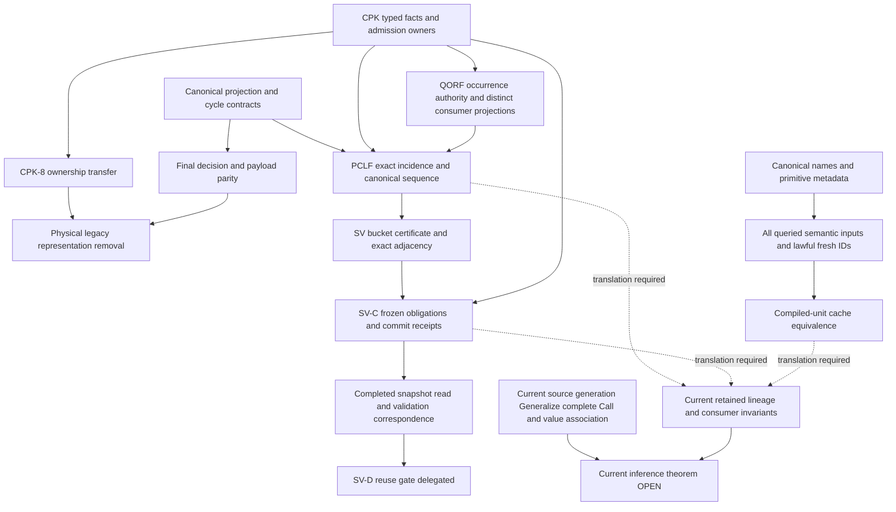

# Oracle document appendix C: proof representation, validation and cache

Date: 2026-10-12
Status: full selected document reads; unreviewed research audit
Oracle baseline: `a58eefc31e22141574b6f20c6a5748151c6d79f1`
Output lease: this file only; primary-assigned leaf, no delegation
Scope: nine historical documents and their recorded history; no compiler inspection

## 1. Evidence boundary and coverage

This appendix audits historical definitions, migration decisions, conditional
arguments and reported checks. An approved storage design is not a typing
soundness or principality theorem. A historical test result is reported evidence,
not a check executed by this audit. No result below promotes the current
Simple-sub parent gate or certifies Oracle compiler behavior.

Every pinned body below was read in full, including appendices: **8,461 lines,
460,143 bytes**. Line locators refer to these blobs, not current working files.
Bounded reads that displayed an internal omission were repeated over the omitted
range. ADD/revision metadata and the common deletion were inspected through
read-only Git queries. Complete earlier revision bodies and every patch were
not separately reread; the CPK-8 approval and 8F amendment deltas were read.
Uncommitted, pruned or inaccessible approval receipts were not searched.

The following two original packet inputs were **explicitly delegated by the
primary to another lane**, not covered here:

- `notes/design/2026-08-13-cpk-sv-d-sealed-conservative-cache-plan.md`
- `notes/design/2026-08-14-cpk-sv-d-ss2-read-foundation-resequencing-addendum.md`

Current interpretation follows the existing core audit and current authority:
historical row/constraint/proof SCCs are distinct from actual Value-reference
intrusion; current residual constructor lineages must remain distinct; complete
Call, scoped generalization and source-to-runtime hygiene retain their original
obligations. The October 11 top-level inference principles govern current
abnormal paths. Historical exact diagnostic and whole-attempt rollback clauses
are not imported as universal current correctness requirements.

## 2. Frozen documents, dates and approval scope

All paths in the following table are under `notes/design/`. Short commit IDs
are unique locators in the inspected repository; exact ADD IDs are expanded in
§7. No path rename was identified in the existing corpus census. All nine paths
were deleted at `9f03827ff44f0b95ff01de1bee55953324831b51`, authored August 18,
2026, 09:44:25 +09:00, with the clean-slate branch transition. Deletion is
historical retirement, not a mathematical refutation or an approval revocation.

| Document | Full coverage / pinned blob | Declared status, history and approval scope |
| --- | --- | --- |
| `2026-08-07-cpk-8-legacy-removal-plan.md` | L1–778; `7e842dcbbfdb4ecef967300369de43d9625771a8` | Declared August 7, user-approved. ADD `3a6dda6e8` initially approved 8A–8F and required separate 8G confirmation; `8736169ba` records the user's same-day advance 8G approval; `195b35fc4` changes the 8F gate and adds Replay fallback sealing. L5–12 explicitly covers 8A–8G subject to prerequisites. The old pending-review footer at L776–778 remains stale; preserve this mismatch, rather than treating it as the latest decision. |
| `2026-08-07-cpk-8g-4b-cycle-cut-parity-addendum.md` | L1–659; `42c4719c9407db330c4ae18d67e955ca7ab191eb` | Declared August 7, user-approved at L5; ADD `bc3023322`, no subsequent body revision in anchor ancestry. Changes cross-authority cycle-cut occurrence parity only; preserves final decision/payload/publication parity and cycle safety. No separate direct user receipt was inspected. |
| `2026-08-07-cpk-8g-physical-removal-plan.md` | L1–304; `2bed19a1af9771e0ac9557dbcb41ccc8682f1730` | Declared/user-approved August 7, L3–19; ADD `ce4d7f181`. Concretizes CPK-8 §5/8/9/10 after 8F; no claim to replace the parent plan. |
| `2026-08-11-projection-clause-link-factorization.md` | L1–1834; `d92cd6a8ecb624035fb38c97ab8741fe796a198f` | Declared rev.3 and user approval August 11. ADD `24052949e` contains rev.2; `ae29aa56f` selects rev.3 canonical iteration; `ef7197cf6` adds bounded chunk findings; `098aaf444` adds F closeout. Rev.2 A/B/C authority remains; rev.3 replaces iteration/D0 onward, L15–50. Header explicitly leaves full-suite completion open. |
| `2026-08-12-cpk-preflight-structural-validity-addendum.md` | L1–964; `171bb10c044e53d49c2b5f1e745e539fe483ff9f` | Declared/user-approved August 12, L3–22; ADD `5c91ba4ab`. Approves Branch A/B, evaluator separation and SV-A–E slices, with non-guaranteed performance targets. Adds a limited structural-cache exception to CPK's cache non-goal, not permanent projectability memo. |
| `2026-08-12-qualified-parent-replay-occurrence-factorization.md` | L1–1938; `6ca2b2f172394e1317dc559f8e10c04be1e4df9f` | Declared/user-approved August 12, rev.3; ADD `91f492e26`; `6470e88f5` records accepted D1 performance deferral; `f6eef554c` records F closeout. Header calls A–F complete, while closeout explicitly reports partial suite coverage. Draft rev.2/rev.3 corrections are described in L15–35; separately committed rev.1/rev.2 bodies were not found by this exact-path history. |
| `2026-08-13-cpk-sv-c-dynamic-dependency-synchronization-addendum.md` | L1–1124; `6b39e4b2123120d3bd063079ea1fabc5fa52a664` | Declared/user-approved August 13, rev.2, L3–22; ADD `fec980beb`. Partly replaces SV §§3.4/5.2/8.2/9-C and dependent stop conditions. Retains SV-A/B; approves R0–R3 and the three documented review-gap repairs. No separate receipt was inspected. |
| `partial-compilation-cache-plan.md` | L1–575; `b8447fe6ea3a50ae56bdaa5628fc9c516e358602` | Undated working plan; ADD May 6 `726a088fc`; 18 ancestry events through June 26 `539c2ecd6`. L3–9 records June 26 operational progress and redirects current operational summary to `docs/cache.md` and the surface-merge note. No explicit user approval. Retained Phase 0/near-term sections are older plan text, not evidence that June 26 progress was absent. |
| `std-special-case-audit.md` | L1–285; `7ab43432322e0054c36c791d958781f09a22701b` | Undated working audit; ADD May 8 `f4fbc5d3e`, revised `7af445ddc`, crate-name revision May 12 `941f4873a`. No explicit user approval. “Recently Removed” contains historical implementation assertions; the earlier hotspots/next-removal prose is not a reconciled current code census. |

Approval evidence is **document-reported approval**, supplemented by revision
commit metadata and, for CPK-8G, a quoted decision in its amendment. Historical
author/reviewer names establish provenance, not independent certification by
this audit. No current implementation authority is granted by these entries.

## 3. Definitions, arguments and retained obligations

### C1. CPK-8 removal and physical ownership

CPK-8 separates two authorities, `ProofReadAuthority` for projection/routing and
`ReplayReadAuthority` for the older factored representation (§1). Sole final
decision authority does not mean legacy inputs/writers are gone. §2 preserves
semantic bounds, queues, IDs, row state and publication provenance; allocation,
first representatives, snapshots and prepared writer inputs must transfer
before mirrors disappear. §3 lists 28 removal invariants. §§4–10 specify
organic/injected failure separation, three-round soak, hard failure with no
partial publication, exact identity, canonical ordering and stage rollback.
These are migration contracts and verification gates, **not derivations of
inference termination, soundness or principality**.

The August 7 amendment (L479–539) corrects the mistaken assumption that sealing
Proof fallback also sealed Replay fallback. It splits non-test production
reachability from crate-wide reference deletion and introduces 8F-3. This is an
approved change of migration gate, not a proof that the former gate held.

Physical-removal §§3–5 selects a dense CPK-owned claim arena with atomic
admission. Sparse flat ownership prolongs the removed owner; a shared allocator
splits ownership; reservation alone risks holes and partial IDs. Full lineage
payload precedes allocator migration. `SchemeProjectionEvaluator` and premise
reverse indexes are still load-bearing dependencies (§4), so “delete the claim
store” cannot substitute for moving their responsibilities. §§7–8 order 17
slices and distinguish the code boundary (reader deletion) from deployed-state
boundary (first writer stopped). The parent plan's retrospective invariant
count is not a fresh exhaustive invariant proof.

### C2. Cycle-cut parity: bounded witness and general premise

The cycle addendum §1.3 supplies the discriminating two-node shape:

```text
source    = dependent OR independent-standalone-true
dependent = source
```

Cycle-first evaluation observes a cut before returning true; standalone-first
evaluation short-circuits with true and observes no cut. This demonstrates why
cut occurrence/count equality is stronger than final truth equality for this
graph. It does not alone prove shared memo safety for all graphs.

The selected c2 route uses typed canonical order
`Standalone < DerivedUnary < ReplayConjunction` and preserves independent OR
arms, full canonical payload, before/after publication, and fresh/shared final
decision equivalence (§§2–3/6–7). It explicitly supersedes only CPK-4 and
projection Slice B cross-authority cut-occurrence equality (§4.1/11). Circular
routes still return false; any observed cut discards sharing for remaining
queries. The precise falsifier is an unobserved cut leaving context-dependent
`Done` or escaped `Visiting`, or a production output depending on cut occurrence
(§10). The text states these as required premises/gates, not a general theorem
proved here. Historical-order mirroring, insertion-order restoration, changing
the retiring flat evaluator, and exhaustive OR evaluation are rejected (§5).

### C3. PCLF: exact incidence factorization and performance corrections

PCLF §1.5 defines record-local clause set `C(r)`, raw support set `S(r)` and
exact relation `L(r) subseteq S(r) × C(r)`. It shares full clause bodies and
support groups but retains every logical incidence and incidence-local source
metadata. Raw representative identity is distinct from normalized root keys.
Record formulas are OR, replay clauses are AND, and only a new distinct clause
adds dependency edges (§§2–3). Round memo stores the decisive exact ID pair,
not a value reconstructed by searching (§5).

The decisive rev.1 premise failed: one exact clause can be reached from distinct
raw supports with `ReplayConstraint { result }`, `ReplayEvidence`, or different
results (§1.3). The measured zero-conflict workload does not imply universal
source uniformity. Rev.2 therefore keeps source at incidence ownership. Rev.3
replaces category-by-all-support nested iteration after three parity-preserving
attempts regressed 10–20% (§0/9/10). Attribution lookup alone was not established
as the cause; individual topology/cache effects remain working hypotheses.

The 1,800 descending singleton case exhibited `N(N-1)/2 = 1,619,100`
comparisons for a flat run. Bounded 128-entry chunks and prepared owned AVL
nodes give local payload work plus logarithmic routing, while preserving the
full canonical sequence (§§3–4). Actual storage proxy corrected a calculation
error from 36.34% to 47.9024%; D0 reports 47.314120% (§9.4). These are reported
artifact/measurement findings. §6's universal expansion/sequence equivalence
are required invariants; no induction over every actual writer path is supplied.

PCLF-F L1397–1434 records 32-minute suite cap: 750 passed, 2 known failures,
489 unfinished; no independently separated proof-writer self-time. Complete
selected text coverage must not turn that record into full-suite verification.

### C4. QORF: consumer-specific parent projections

QORF retains exact occurrence `(result, BinaryReplayDerivation)` and exact
parent `(occurrence, side, root)` with historical silent first-wins representative
and lineage (§§2–3). It promotes the **current CPK finite-map ledger**, not the
retired RCPF occurrence store. Side-local chunks answer membership; one
canonical arm per occurrence serves evaluation; a separate canonical minimum
per `(result, root)` serves materialization; an exact association cursor serves
all required `(root, carrier)` outputs. First source/witness is not the canonical
root winner. Late additions can rekey an arm or replace a winner without
rewriting the retained exact parent's first-wins metadata.

The crucial evaluation reduction premise is §3.5/5.1: root, side,
representative and lineage do not change carrier boolean evaluation, validation
or first-error/provenance behavior. The document reports independent historical
code review and asks fixtures to retain that fact; this audit inspected no code.
An arm sufficient for evaluation is explicitly insufficient for other consumers.
Its stable-first sequence equality is a required correspondence, not a typing
theorem.

Rev.3 corrects the transaction boundary (§4). Recoverable inner preparation
failure publishes no parent/side/arm/winner/summary delta; the outer replay
event still appends once. `first_event` is the pre-append length, the subsequent
event's zero-based index. Accepted-zero parent work is not an event-ledger no-op.
The invariant applies to replay plus later structural/reduction winner updates.

D1 landed with explicitly user-accepted performance deferral (§8/9/11): three
cold samples per alternative showed +3.27% parse and +2.81% full lowering.
The exception was D1-only. E/F later report resolved regression, 50,390,357
parent comparisons with zero mismatch, 865,571 occurrences/arms and 1,792,654
root winners (L1451–1494). This remains workload-specific correspondence.
The suite stopped with 768 passed, 1 known failure, 2 ignored, **490 unfinished**;
writer self-time was not separately measured. Header completion includes these
documented limitations. Appendix A distinguishes the removed one-off census
from the required retained harness, and gives an exact comparison algorithm.

### C5. Structural validity is separate from projectability

The SV addendum §§3–5 separates three claims:

- bucket-local certificate: canonical order, incidence membership and support
  relation at one formula revision;
- exact typed adjacency: validation actions, without coarse root-only collapse;
- `Valid(snapshot)`: successful mandatory structural traversal at the same
  completed attempt-local structural snapshot.

The certificate proves no external claim movement, liveness or carrier fact.
`Valid` stores no projectability, winning arm, cycle result, failure or owner.
All mandatory read mutations must invalidate reuse. Candidates publish only
after successful top-level unwind; checked-set insertion is merely a
termination guard (§5.5). Optional cache allocation failure uses uncached
validation. Unordered fast failure reruns canonical validation for first error.

The sharp documented shape is `A -> B`, `B -> A`, `A -> dangling C` (§8.4).
B can finish locally before A later fails; publishing B from local checked state
would leak invalid success. The claimed safeguard depends on separate candidate
publication after the entire traversal succeeds. The header reports historical
adversarial review of this premise; it is not independent proof review here.

The RMW range is N=1..6 (§2), not exhaustive source programs. Later-serial
unchanged rescan was only 8 records/14 clauses, so cross-epoch delta validation
was rejected in favor of same-snapshot reuse. Accepted consequences were not
deduplicated by local isomorphism. Performance targets remain explicitly
non-guaranteed (§10). Admission certificates and cache equivalence require
construction/invalidation completeness; measurements do not establish it.

### C6. SV-C stable obligations and commit receipts

The SV-C rev.2 addendum replaces dynamic leaf copies in formula adjacency with
`ClaimBinding(representative, expected_root)` and
`CoverageRootState(expected_root)` (§4). Current bound and live states come from
their single owning authorities at query time. Expected root comes from frozen
exact incidence; representatives remain distinct. Formula/support-ledger closure
is checked in both directions. A certificate covers only the frozen bucket
relation. Semantic publication reverse maps remain; only validation-copy fanout
is removed (§6.3).

§§1–3 report three review rounds exposing identity omissions, opposite prepared
snapshot windows, quadratic maintenance and silent commit loss. The minimized
silent-loss sequence is: prepare A and B against one formula base; commit A;
stale B returns `()` without formula mutation; the caller publishes B's
secondary dependency from prepared intent. A successful typed commit receipt
is the selected publication authority (§5). Existing sibling mutation followed
by formula conflict terminates the private attempt rather than publishing it.
Generation alone detects stale state without solving capacity, reconciliation
or ownership; retaining copied leaves merely preserves those obligations (§11).

§7.3's **No-missed-dependency proof** is a conditional implementation argument.
Its explicit premises are: (H1) exclusive mutations and queries observe completed
states; (H2) every claimed incidence constructs and atomically publishes its
frozen pair and root obligation; (H3) retained IDs stay stable across movement;
(H4) late-bound resolution reads every mandatory current fact; (H5) static
actions and formula/support-ledger closure are complete; (H6) the refined
canonical path also checks frozen/current divergence and live-index consistency.
Then obligations persist with incidence, read the current authorities rather
than stale copies, and cover the same mandatory relation at a fixed snapshot.
This is a valid explanation of the construction under those premises; the
document's argument does not independently prove all actual constructor,
transaction, query or consumer paths satisfy them. Typed receipts additionally
prevent secondary publication from an unsuccessful commit only when every
caller obeys the receipt API.

The expected trace oracle (§10.1) is stronger than self-comparison: it records
actual canonical preflight read sites and forbids the writer's translation
helper on the expected side. Both sides still share the selected canonical
preflight contract and snapshot/identity assumptions. Consequently it can test
implementation read-set correspondence, not independently prove source typing
rules. Frozen/current corruption requires refined canonical failure, not a
legacy fallback that silently succeeds (§4.4). R3 precedes SV-D read authority;
this file does not claim R0–R3 implementation completion.

### C7. Persistent compiled units and structural std identity

The partial-cache plan defines a source-file dependency SCC as the artifact
unit, with realm/band identity as context, not as the SCC itself. It separates
manifest, syntax, namespace, typed and runtime surfaces (§§1/203–377). Syntax
must precede dependent parsing; unit-local IDs map to fresh process IDs; cached
schemes, roles and effects remain required; canonical conflict checks and
principal-evidence remapping govern runtime merge. Ambient casts are recorded
only when consulted through a dependency-recording boundary (L336–362).

June 26 status reports conservative full-source/prefix/dependency-closure reuse,
while dependent-only external-reference artifacts, interface hashes and package
invalidation remain unimplemented (L49–159). Serialization feasibility or a
cache hit does not prove that imported schemes are principal or that all hidden
evidence survives. Historical cache equivalence depends on complete surfaces,
lawful renaming and complete input fingerprints. The plan's “prove” wording
about prototypes denotes reported serialization/import feasibility, not a
formal source theorem.

The std audit retains sugar entrypoints and isolated bootstrap, while targeting
suffix/exact-path signature filling, accidental role/effect matches and
post-hoc inference supplements. It uses canonical identities, primitive family
tables and structured metadata; normal effect-parent/child prefix matching is
distinct from arbitrary suffix matching. “Recently Removed” (L167–271) reports
the withdrawal of Fold/item, special associated signature closure and other
shortcuts. Earlier hotspots and next-removal text remain mixed with later
removal claims. No independent current zero-reference census was run.

## 4. Dependency graph and Simple-sub transfer limits



The edges are historical obligations or candidate transfer routes, not theorem
closure. QORF must preserve the exact association stream consumed by PCLF;
PCLF's compact clause input precedes SV structural certificates; SV-C changes
the owner of dynamic validation knowledge; complete mutation coverage precedes
any successful-validation cache. The two delegated SV-D/SS2 documents may amend
the final cache/resequencing edges and require their own audit.

Reusable design lessons, conditional on current owner correspondence, include
retaining exact incidence and frozen provenance; separating first-wins from
canonical winner; retaining distinct evaluation and exact-output projections;
deriving facts once at their owners; publishing receipts rather than intent;
and separating structural success from context-dependent projectability.
None selects the current source meaning, maps proof IDs to actual source values,
justifies merging equal residual keys, proves qualifying parent/copy equality,
or replaces the whole Call/generalization tuple with a marginal witness.

Former CPK flat/RCPF stores, migration oracles, old local decision rules,
artificial early satisfiability requirements and registry prerequisites are
historical dependencies. Their retirement removes obsolete transfer edges;
it does not mark them proved, and does not retire genuine effect hygiene,
soundness or principality obligations. Any retained cache optimization needs
the current Simple-sub generation/propagation/levels/extrusion/intrusion and
generalization correspondence at every relevant owner. Old exact diagnostic,
complete restoration and replay/retry requirements cannot override October 11
authority; successful publication consistency remains necessary.

## 5. Exact history ledger

Ancestry change events, oldest first; dates are author dates in +09:00.
Full pinned bodies, not these metadata rows, supply the claims above.

| Document | Events through Oracle anchor |
| --- | --- |
| CPK-8 | August 7 02:26:43 ADD `3a6dda6e8`; 11:41:24 approval expansion `8736169ba`; 18:24:04 8F amendment `195b35fc4` |
| Cycle parity | August 7 23:39:45 ADD `bc3023322` |
| Physical removal | August 7 20:30:49 ADD `ce4d7f181` |
| PCLF | August 11 12:20:49 rev.2 ADD `24052949e`; 17:17:08 rev.3 `ae29aa56f`; 19:18:42 bounded chunks `ef7197cf6`; 22:35:22 closeout `098aaf444` |
| Structural validity | August 12 20:27:56 ADD `5c91ba4ab` |
| QORF | August 12 01:55:53 rev.3 ADD `91f492e26`; 08:45:30 D1 deferral `6470e88f5`; 09:51:50 F closeout `f6eef554c` |
| SV-C | August 13 09:57:42 rev.2 ADD `fec980beb` |
| Std audit | May 8 00:13:56 ADD `f4fbc5d3e`; 02:01:20 removal update `7af445ddc`; May 12 12:50:29 crate rename `941f4873a` |

Partial-cache events: May 6 19:33:33 ADD `726a088fc`, 19:36:46 operator
surfaces `3c4a11255`; May 9 20:46:43 realm/band `33b6d0a9d`; May 12
12:50:29 crate rename `941f4873a`; May 15 21:12:18 cast dependencies
`328fb158f`; May 20 13:10:46 incremental strengthening `7b836c989`; June 25
23:12:34 manifest validation `ef9ed1198`, 23:20:39 unit graph `3491db1df`,
23:29:50 keys `efba50912`, 23:36:02 closed selection `9accdbe42`, 23:42:14
unit keys `27a96ba8e`, 23:52:20 cache selection `9734be4c4`; June 26 00:01:21
child preservation `e975368a7`, 00:09:49 visibility `94091d515`, 00:23:54
synthetic parent input `680eef9c9`, 00:30:11 standalone artifacts `d0aad313b`,
09:51:35 operational routes `e293b869c`, 10:10:02 artifact rename/release gate
`539c2ecd6`. These are 18 events, not 18 independently checked implementations.

## 6. Checks, independence and omissions

Commands already run: bounded `git show BASE:PATH | nl -ba | sed -n RANGE`;
`git log BASE --format=... --name-status --no-renames -- PATHS`;
`git log --all --diff-filter=ADR --name-status --no-renames -- PATHS`;
CPK-8 amendment patch reads; Python standard-library line/byte and SHA-256
inventory from immutable Git blobs. No compiler reads, builds, tests, runtime
or performance experiments, mutations, seeds or model searches were run.

The historical linear reconstruction and old/new visibility/validation oracles
share the accepted legacy contracts and identities. They offer representation
and operational parity within their recorded workloads, not an independent
oracle for source inference soundness. SV-C explicitly requires actual canonical
read traces instead of a shared translation helper; even that distinguishes
read-set agreement from correctness of the source-generated rules. Historical
mutations/fault injection are fixture requirements or reported results, never
checks claimed executed here.

Local processes were short document/history/hash reads; no heavy process budget
was consumed. Exact aggregate CPU, peak RAM and wall time were not measured.
Unverified: all implementation/source correspondence, every older revision
body, direct approval receipts beyond reported text, pruned/uncommitted history,
external cited proofs, broad-suite unfinished cases, and the two explicitly
delegated documents. The producer does not certify its own appendix.

Recommended next action: primary combines the separately audited SV-D/SS2
amendments with these owner/identity dependencies, obtains the selected bounded
independent review, and updates catalogue coverage without promoting source
typing or cache-correctness gates from historical test counts.

## 7. Commit packet

- Exact leased changed path:
  `notes/theory/oracle-inference-document-audit/appendix-batch-c.md`.
- Oracle baseline: `a58eefc31e22141574b6f20c6a5748151c6d79f1`.
- Pinned blobs are recorded in §2; none changed. Exact ADD commits:
  CPK-8 `3a6dda6e8875c7d7cc545d53a5746dec40b150fb`;
  cycle `bc30233228e8ccfa59f26a922825bd86c99ef3cf`;
  physical `ce4d7f181232ba098550f6dd5d26d8f925e4c0d6`;
  PCLF `24052949e50ee9afa21f87d6f63fbfbc5d46cbab`;
  SV `5c91ba4ab08e112f546923ac84d02e9b98f4adb8`;
  QORF `91f492e266ccc17e8c256e2fafa4ff7b3d281240`;
  SV-C `fec980beb07e042ebf27a9f2f7f2bf039bcd19bb`;
  partial cache `726a088fcb8e79ca7aa1463c7a63096b4e0028e9`;
  std audit `f4fbc5d3ecee0275b6d932aa3e11b730c93a147d`.
- Context dependency: existing audit README, SHA-256 at inspection
  `979acb7912e8d8fe7050f2bd46a5db4da3aaae622140be75f0fe609988c15de8`.
  Its concurrent primary-owned changes require delta revalidation, not Oracle
  rereading. No shared record was edited by this leaf.
- Review status: unreviewed document audit; no new theorem/cutover authority or
  independent certification.
- Checks already run: complete pinned reads, exact ancestry/deletion queries,
  ADD locators and line/byte/blob inventory; focused Markdown/link checks after
  writing. No tests/builds/probes.
- Proposed checkpoint message:
  `research: audit Oracle proof representation and cache appendices`.
- Shared deltas intentionally left for primary/curator: nine full-read coverage
  rows; exact approval/amendment scope; stale footer and partial-suite caveats;
  PCLF/QORF rejected premises and retained identity rules; SV-C conditional
  hypotheses and independent-trace limits; delegated SV-D/SS2 coverage;
  historical retirement and current transfer edges. No task/index/authority or
  question-board changes are included.
